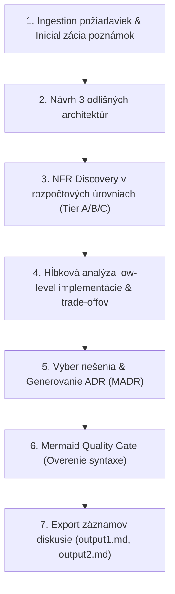

# 🏛️ Architecture Design & Decision Record (ADR) Skill

Tento skill slúži ako komplexný metodický sprievodca pre softvérových architektov a asistentov na:
1. Analýzu požiadaviek systému z textových špecifikácií (`.txt`, `.md`).
2. Návrh **troch kvalitatívne odlišných architektonických paradigiem** s ich trade-offmi.
3. Štruktúrovanú identifikáciu nefunkčných požiadaviek (NFR) rozdelených do **rozpočtových balíkov (Tier A / B / C)** bez nutnosti pýtať sa na presné finančné sumy.
4. Hĺbkovú analýzu low-level implementačných rizík (konkurencia, inventory locking, race conditions, webhook loops, SMTP throttling).
5. Tvorbu profesionálneho **Architecture Decision Record (ADR)** podľa štandardu MADR s overenými **Mermaid diagramami bez syntaktických chýb**.
6. Priebežné vedenie architektových poznámok počas celého procesu.

---

## 📋 Pracovný postup pri aktivácii `/architecture`



---

## Fáza 1: Ingestion požiadaviek a inicializácia poznámok

1. **Lokalizácia špecifikácie:**
   - Prečítaj súbor s požiadavkami (napr. `EventTicket.txt`, `EventTicket.md`, špecifikácie v priečinku `data/`).
   - Identifikuj:
     - Kľúčové entity a roly (napr. Anonymous Client, Registered User, Manager, Admin).
     - Kritické biznis toky (platby, registrácie, publikácia obsahu, notifikácie).
     - Kritické body zlyhania (prepredaj vstupeniek, vyčerpanie DB spojení, škálovanie).

2. **Vytvorenie bežiacich poznámok:**
   - Vytvor súbor `architecture_notes.md` v adresári artefaktov (alebo v pracovnom priečinku).
   - Tento súbor aktualizuj po každom kroku diskusie o architektonických rozhodnutiach.

---

## Fáza 2: Návrh 3 kvalitatívne odlišných architektúr

Navrhni **3 skutočne rozdielne architektonické štýly**. Každý návrh musí obsahovať:
- **Štrukturálny princíp:** Ako sú komponenty organizované.
- **Riešenie konkurencie / stavu:** Ako systém garantuje konzistenciu dát (ACID, transakcie, zámky).
- **Rozpočtový & Prevádzkový profil:** Náročnosť na infraštruktúru a údržbu (VPS, Kubernetes, Serverless).
- **Low-level implementačné bolesti:** Kde vznikajú technické komplikácie (deadlocky, cold starts, saga kompenzácie).

### Štandardné trio architektúr:
1. **Multi-Process Modular Monolith (Pragmatic / Decoupled Worker):**
   - 1 repozitár, 1 databáza (PostgreSQL + PgBouncer), 1 Redis na fronty.
   - Nasadené ako nezávisle škálovateľné kontajnery (Web/SSR proces + Worker proces).
   - *Vhodné pre:* Malé tímy, nízky rozpočet (Tier A), potreba nezávislého škálovania komponentov.
2. **Event-Driven Microservices:**
   - Samostatné služby (Catalog, Ticketing, Payment, Notification) s vlastnými DB a asynchrónnym brokerom (RabbitMQ/Kafka).
   - *Vhodné pre:* Veľké tímy, enterprise škálovanie. Pre malý tím obrovský prevádzkový dlh.
3. **Cloud-Native Serverless SSR (PaaS / FaaS):**
   - Edge SSR (Vercel/Cloudflare) + API Gateway + FaaS (Lambda/Cloud Run) + Managed Serverless DB + Cloud Queues (SQS FIFO).
   - *Vhodné pre:* Nulové servery, platba za použitie, riziko cold startov a vyčerpania DB spojení pri flash-sale dropoch.

---

## Fáza 3: Budget-Aligned NFR Discovery (Úrovne Tier A / B / C)

Namiesto otázky *"Aký máte rozpočet v eurách?"* ponúkni používateľovi **3 úrovne možností (Tier A, Tier B, Tier C)** pre každú dimenziu:

| NFR Dimenzia | Tier A (Lean / Budget) | Tier B (Balanced / Growth) | Tier C (High Scale / Enterprise) |
|---|---|---|---|
| **Dostupnosť (Uptime)** | **99.0%** (1 zóna, auto-restart, denný backup, RTO 1-2h) | **99.9%** (Multi-AZ failover, point-in-time recovery) | **99.99%** (Multi-region active-active, zero-downtime deploy) |
| **Záťaž & Konkurencia** | Stabilná malá záťaž (<100 súbežných nákupov, DB row lock) | Návalové dropy (500–2,000 používateľov, Redis fronty, CDN keš) | Masívne flash-sales (10,000+ používateľov, virtuálna čakáreň / FIFO token) |
| **Platby & Bezpečnosť** | Hosted Checkout (Stripe Checkout / PCI SAQ A, nulová réžia) | Embedded Elements (Vlastný UX na stránke, tokenizácia) | Vlastný payment processing (Plná PCI DSS certifikácia) |
| **Notifikácie** | Dávkové asynchrónne odosielanie (doručenie do 1-5 min) | Rýchle doručenie (<15 sekúnd, dedikovaný worker, retry) | Okamžitý real-time stream + SMS/Push multikanál |
| **Tím & Prevádzka** | 1–3 vývojári (jednoduchý monorepo, Docker Compose) | Malý tím s 1 DevOps inžinierom | Plnohodnotný 24/7 SRE / Platform tím |

---

## Fáza 4: Low-Level Mechanics & Concurrency Deep-Dive

Preskúmaj konkrétne technické úskalia zvolených kombinácií:
1. **Stratégia inventára pri externých platbách:**
   - *Soft-lock s TTL (10 minút):* Rezervuje lístok počas zadávania karty na Stripe; pri expirácii uvoľňuje.
   - *First-to-Pay-Wins (Optimistická):* Lístok sa nerezervuje; kto prvý zaplatí, ten ho má.
   - *Riziko First-to-Pay-Wins:* Stripe **nevracia transakčné poplatky** (2.9% + 30¢) pri refundoch! Prepredané platby si vyžadujú okamžitý webhook refund loop (`stripe.Refund.create`).
2. **Atomický SQL update pattern:**
   ```sql
   UPDATE events 
   SET remaining_tickets = remaining_tickets - :qty,
       version = version + 1
   WHERE id = :event_id AND remaining_tickets >= :qty
   RETURNING id;
   ```
3. **Notifikačný Fan-Out & Rate Limiting:**
   - Rozdelenie zoznamu odberateľov do streaming dávok (po 500 ID).
   - Paralelné vlákna workerov rešpektujúce API rate-limity providera (50–100 req/s) pre dosiahnutie <15s cieľa.

---

## Fáza 5: Generovanie ADR (Architecture Decision Record)

ADR musí dodržiavať štruktúru **MADR (Markdown Any Architectural Decision Record)**:
1. **Title:** `ADR-001: Architecture Selection for [Project Name]`
2. **Status:** Accepted / Decided
3. **Context and Problem Statement:** Sumár funkčných požiadaviek a biznis cieľa.
4. **Decision Drivers & Constraints:** Tím, SSR, rozpočet, Tier NFRs.
5. **Detailed Explanation and Visualization of Candidate Architectures:**
   - Sekcia pre každú z 3 možností s textovým vysvetlením a Mermaid diagramom.
6. **Architecture Comparison Matrix:** Tabuľkové porovnanie všetkých 3 kandidátov.
7. **Decision Outcome:** Detailné zdôvodnenie víťaznej architektúry.
8. **Low-Level Implementation Protocols:** SQL dotazy, webhook handling, refund workflows.
9. **Consequences & Trade-offs:** Pozitívne dôsledky, riziká a konkrétne mitigácie.

---

## Fáza 6: Mermaid Diagram Quality Gate (Pravidlá syntaxe)

Aby sa predišlo chybám typu **`Syntax error in text`** v náhľadoch Markdownu (VS Code, GitHub, GitLab):

> [!CAUTION]
> **Kritické pravidlá pre Mermaid diagramy:**
> 1. **ŽIADNE zátvorky v popiskoch šípok:** Zápis `-->|HTTP GET (SSR)|` spôsobí lexer error (`PS` token). Použi: `-->|HTTP GET SSR|`.
> 2. **ŽIADNE zobáčiky `<` alebo `>` v popiskoch šípok:** Zápis `-->|Odoslanie <15s|` sa interpretuje ako HTML tag. Použi: `-->|Odoslanie do 15s|` alebo `-->|Odoslanie under 15s|`.
> 3. **ŽIADNE ampersand zreťazenia v cieľoch:** Zápis `CDN --> Web1 & Web2` zlyháva na starších rendereroch. Použi explicitné prepojenia:
>    ```mermaid
>    CDN --> Web1
>    CDN --> Web2
>    ```
> 4. **Vždy dávaj texty uzlov do úvodzoviek:** `NodeId["Čitateľný názov"]`.
> 5. **Používaj bezpečné hranaté uzly namiesto vnorených valcových:** `Postgres["PostgreSQL DB"]` namiesto `Postgres[("PostgreSQL DB")]`.

---

## Fáza 7: Export záznamov diskusie

- Ukladaj priebežný záznam konverzácie do súborov:
  - `output1.md`: Fáza 1 až Fáza 4 (Diskusia návrhov a zladenie požiadaviek).
  - `output2.md`: Fáza 5 až Fáza 6 (Tvorba ADR, vizualizácie a iterácie spätnej väzby).
- Oba súbory musia obsahovať kompletné znenie dialógu a aktuálny stav `architecture_notes.md`.
