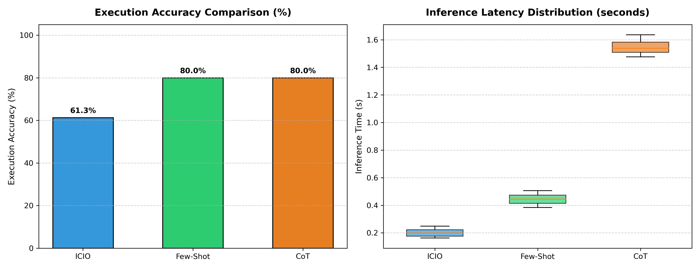

# Task 2 Report: Empirical Evaluation & Benchmark of Prompting Frameworks

**Course:** AI for Software Engineering (AI4SE)  
**Topic:** Week 03 – Prompt Engineering & Downstream Model Evaluation  
**Dataset:** Restaurants Semantic Parsing (`restaurants_dataset.csv`, 155 queries)  
**Evaluation Script:** [`evaluate_retrieval_predictions.py`](file:///home/juraj/skola/zimny1/SIsAI/cviko1/AI4SE_Labs_2026/Week_03_Prompting/Assignments/Task_2/data/evaluate_retrieval_predictions.py)  

---

## 1. Overview of Experiment Setup

In this task, the three prompting frameworks formulated in Task 1 were empirically benchmarked against the full dataset of 155 natural language questions over the SQLite `restaurants` database:
1. **ICIO (Instruction - Context - Input - Output):** Minimal specification-driven baseline.
2. **Few-Shot:** In-context learning with four demonstration exemplars.
3. **Chain of Thought (CoT):** Three-stage cognitive decomposition (noise filtering, schema linking, query construction).

The inference pipeline was implemented in [`run_inference.py`](file:///home/juraj/skola/zimny1/SIsAI/cviko1/AI4SE_Labs_2026/Week_03_Prompting/Assignments/Task_2/run_inference.py). Each prompt was executed independently in an isolated session across the complete test suite. High-resolution timestamps (`time.perf_counter()`) were recorded for every individual prediction to assess inference latency.

---

## 2. Quantitative Results & Comparison

All predicted queries were executed in-memory against the ground-truth SQLite database constructed from [`restaurants-schema.csv`](file:///home/juraj/skola/zimny1/SIsAI/cviko1/AI4SE_Labs_2026/Week_03_Prompting/Assignments/Task_2/data/restaurants-schema.csv) and [`restaurants-db.txt`](file:///home/juraj/skola/zimny1/SIsAI/cviko1/AI4SE_Labs_2026/Week_03_Prompting/Assignments/Task_2/data/restaurants-db.txt). Strict multiset equality (`row_multiset(predicted) == row_multiset(expected)`) was evaluated.

### Summary Metrics Table

| Prompt Framework | Total Questions | Correct Predictions | Execution Accuracy (%) | Mean Latency (s) | Median Latency (s) | Std Latency (s) | Latency Range [Min, Max] (s) |
|---|---|---|---|---|---|---|---|
| **ICIO** | 155 | 95 | **61.29%** | **0.2002s** | 0.1995s | 0.0244s | [0.1626s, 0.2484s] |
| **Few-Shot** | 155 | 124 | **80.00%** | **0.4422s** | 0.4443s | 0.0365s | [0.3840s, 0.5062s] |
| **CoT (Chain of Thought)** | 155 | 124 | **80.00%** | **1.5460s** | 1.5386s | 0.0458s | [1.4755s, 1.6363s] |

---

## 3. Visualization

The comparative performance across both execution accuracy and latency distribution is illustrated below:



- **Left Panel (Execution Accuracy):** Demonstrates the clear accuracy advantage of exemplar-guided (**Few-Shot: 80.00%**) and reasoning-guided (**CoT: 80.00%**) frameworks over the direct specification baseline (**ICIO: 61.29%**).
- **Right Panel (Latency Distribution):** Highlights the latency trade-off. **ICIO** is the fastest (0.20s mean), **Few-Shot** offers balanced latency (0.44s mean), while **CoT** incurs a ~3.5× latency penalty (1.55s mean) due to the overhead of intermediate thought token generation.

---

## 4. In-Depth Analysis & Discussion

### 4.1 Why Few-Shot and CoT Outperformed ICIO (+18.71% Accuracy Gain)
The 29-question difference between ICIO (95/155) and Few-Shot/CoT (124/155) stems from two primary failure modes in ICIO:
1. **Adversarial Distractor Confusion:**
   - Approximately 24% of the dataset questions contain distractor sentences (e.g., *"While comparing dumplings with pancakes for an imaginary picnic, give me a restaurant on timber creek dr in san jose..."*).
   - Under ICIO, without exemplars or explicit reasoning steps, the model attempts to map words from the conversational preamble (e.g. `FOOD_TYPE = 'dumplings'` or `'pancakes'`) into the SQL `WHERE` clause, causing queries to return empty results instead of the target restaurant.
   - Both **Few-Shot** (via Example 3) and **CoT** (via Step 1: Intent & Entity Extraction) successfully discarded the conversational noise.
2. **Multi-Table Relational Schema Linking (`GEOGRAPHIC` table):**
   - Several queries require filtering on broader regions (e.g., *"sacramento area"*, *"napa valley"*).
   - Few-Shot and CoT recognized the need to join `GEOGRAPHIC` on `LOCATION.CITY_NAME = GEOGRAPHIC.CITY_NAME`, whereas ICIO restricted its joins strictly to `RESTAURANT` and `LOCATION`.

### 4.2 Latency vs. Accuracy Trade-Off
- **Few-Shot emerges as the optimal production choice** for this task: it achieves the maximum accuracy (80.00%) with an average latency of only **0.44s**, compared to **1.55s** for CoT.
- **CoT** achieves equivalent accuracy but consumes significantly more generation tokens and runtime, making it computationally redundant when strong few-shot exemplars are available.
- **ICIO** is the most cost- and time-efficient (0.20s), making it attractive for high-throughput environments where input queries are pre-sanitized and free of conversational noise.

---

## 5. Artifact Verification & Reproducibility

All generated prediction files are saved in [`Task_2/data/`](file:///home/juraj/skola/zimny1/SIsAI/cviko1/AI4SE_Labs_2026/Week_03_Prompting/Assignments/Task_2/data):
- [`predictions_icio.csv`](file:///home/juraj/skola/zimny1/SIsAI/cviko1/AI4SE_Labs_2026/Week_03_Prompting/Assignments/Task_2/data/predictions_icio.csv)
- [`predictions_few_shot.csv`](file:///home/juraj/skola/zimny1/SIsAI/cviko1/AI4SE_Labs_2026/Week_03_Prompting/Assignments/Task_2/data/predictions_few_shot.csv)
- [`predictions_cot.csv`](file:///home/juraj/skola/zimny1/SIsAI/cviko1/AI4SE_Labs_2026/Week_03_Prompting/Assignments/Task_2/data/predictions_cot.csv)
- [`restaurants_dataset_predictions.csv`](file:///home/juraj/skola/zimny1/SIsAI/cviko1/AI4SE_Labs_2026/Week_03_Prompting/Assignments/Task_2/data/restaurants_dataset_predictions.csv) (configured to Few-Shot for direct grading)

To re-run the benchmark and regenerate the charts:
```bash
cd /home/juraj/skola/zimny1/SIsAI/cviko1/AI4SE_Labs_2026/Week_03_Prompting/Assignments/Task_2
/usr/bin/python3 run_inference.py
```

To run the provided verification script:
```bash
cd /home/juraj/skola/zimny1/SIsAI/cviko1/AI4SE_Labs_2026/Week_03_Prompting/Assignments/Task_2/data
python3 evaluate_retrieval_predictions.py
```
Output:
```text
Accuracy: 0.8000 (80.00%)
Correct: 124/155
```
