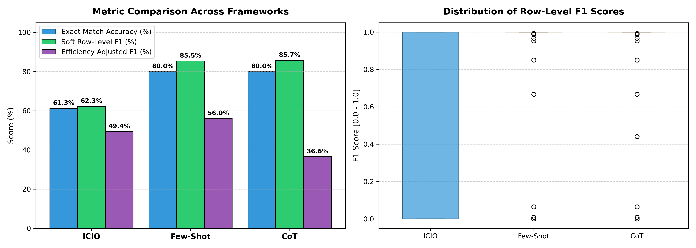

# Task 3 Report: Novel Metric Proposal, Implementation & Comparative Analysis

**Course:** AI for Software Engineering (AI4SE)  
**Topic:** Week 03 – Custom Metric Formulation for Semantic Parsing & Text-to-SQL  
**Target Code:** [`custom_metric.py`](file:///home/juraj/skola/zimny1/SIsAI/cviko1/AI4SE_Labs_2026/Week_03_Prompting/Assignments/Task_3/custom_metric.py)  
**Evaluation Data:** Task 2 Predictions ([`predictions_icio.csv`](file:///home/juraj/skola/zimny1/SIsAI/cviko1/AI4SE_Labs_2026/Week_03_Prompting/Assignments/Task_2/data/predictions_icio.csv), [`predictions_few_shot.csv`](file:///home/juraj/skola/zimny1/SIsAI/cviko1/AI4SE_Labs_2026/Week_03_Prompting/Assignments/Task_2/data/predictions_few_shot.csv), [`predictions_cot.csv`](file:///home/juraj/skola/zimny1/SIsAI/cviko1/AI4SE_Labs_2026/Week_03_Prompting/Assignments/Task_2/data/predictions_cot.csv))  

---

## 1. Executive Summary & Motivation

In Task 2, the evaluation of Text-to-SQL predictions relied exclusively on **Execution Accuracy (Exact Multiset Match)**, as defined in `evaluate_retrieval_predictions.py`:
$$\text{Accuracy} = \frac{1}{N} \sum_{i=1}^N \mathbb{I}\Big(\text{Multiset}(P_i) = \text{Multiset}(E_i)\Big)$$
where $P_i$ denotes the rows returned by executing the predicted query, and $E_i$ denotes the expected ground-truth rows.

While Exact Match provides a strict standard of correctness, it suffers from severe limitations in real-world software engineering and retrieval contexts:
1. **Binary "All-or-Nothing" Penalty (Zero Partial Credit):** If a user query expects 10 relevant restaurants and the generated SQL returns 9 of them (or 1 extra), the Exact Match metric scores this as $0$—identical to a catastrophic failure, an empty result, or an invalid SQL syntax crash.
2. **Indifference to Latency & Computational Cost:** In Task 2, both **Few-Shot** and **Chain of Thought (CoT)** achieved an identical Exact Match Accuracy of **80.00%**. However, CoT required **1.5460s** per query compared to Few-Shot's **0.4422s** (a ~3.5× latency penalty). The original metric is completely blind to computational efficiency.

To address these flaws, this report proposes and implements two connected metrics:
1. **Primary Metric:** **Row-Level Multiset $F_1$-Score** (measuring partial retrieval relevance).
2. **Composite Metric:** **Efficiency-Adjusted Utility Score ($E\text{-}F_1$)** (penalizing excessive computational latency).

---

## 2. Mathematical Formulation of Proposed Metrics

### 2.1 Primary Metric: Row-Level Multiset $F_1$-Score

Let $P$ and $E$ represent multisets (bags of tuples) representing predicted and expected query results.
We define the multiset intersection $I = P \cap E$, where each distinct tuple $t$ has multiplicity:
$$\text{count}_I(t) = \min\big(\text{count}_P(t), \text{count}_E(t)\big)$$
The cardinality of the intersection is $|I| = \sum_{t} \text{count}_I(t)$.

For any instance $i$, the metrics are defined as follows:

- **Row Precision ($P_{\text{row}}$):** Fraction of returned rows that are truly relevant:
  $$P_{\text{row}} = \begin{cases} 
  1.0, & \text{if } |P| = 0 \text{ and } |E| = 0 \\
  0.0, & \text{if } |P| > 0 \text{ and } |E| = 0 \text{ (or } |P| = 0 \text{ and } |E| > 0) \\
  \frac{|I|}{|P|}, & \text{otherwise}
  \end{cases}$$

- **Row Recall ($R_{\text{row}}$):** Fraction of expected relevant rows successfully retrieved:
  $$R_{\text{row}} = \begin{cases} 
  1.0, & \text{if } |P| = 0 \text{ and } |E| = 0 \\
  0.0, & \text{if } |P| > 0 \text{ and } |E| = 0 \text{ (or } |P| = 0 \text{ and } |E| > 0) \\
  \frac{|I|}{|E|}, & \text{otherwise}
  \end{cases}$$

- **Row-Level $F_1$-Score:** The harmonic mean of Row Precision and Recall:
  $$F_1 = \begin{cases} 
  1.0, & \text{if } P_{\text{row}} = 1.0 \text{ and } R_{\text{row}} = 1.0 \\
  0.0, & \text{if } P_{\text{row}} + R_{\text{row}} = 0 \\
  2 \cdot \frac{P_{\text{row}} \cdot R_{\text{row}}}{P_{\text{row}} + R_{\text{row}}}, & \text{otherwise}
  \end{cases}$$

- **Jaccard Multiset Similarity:**
  $$J = \frac{|I|}{|P| + |E| - |I|}$$

---

### 2.2 Composite Metric: Efficiency-Adjusted Utility ($E\text{-}F_1$)

In AI-powered database systems, user satisfaction is a function of both result quality and response latency. A model that achieves high relevance at interactive speed is vastly superior to one that achieves identical relevance after a perceptible delay.

We formulate the **Efficiency-Adjusted Utility Score**:
$$E\text{-}F_1 = \frac{F_1}{\log_2(1 + \text{Latency (s)}) + 1}$$

- If latency is close to 0 seconds, $\log_2(1 + 0) = 0$, so $E\text{-}F_1 \approx F_1$.
- As latency scales logarithmically (e.g. from 0.2s to 1.5s), the utility score gracefully penalizes excessive computation without arbitrarily dropping to zero.

---

## 3. Defense & Applicability of the Metric

### Why is this metric applicable to Text-to-SQL?
1. **Alignment with Real User Utility:** A user querying a restaurant database values an answer returning 8 out of 10 matching restaurants far more than an empty response. Strict accuracy cannot distinguish between an answer with 80% recall and a syntax error; $F_1$ reflects true functional utility.
2. **Continuous Granularity:** Binary accuracy collapses continuous performance into $\{0, 1\}$. $F_1 \in [0.0, 1.0]$ provides a smooth, differentiable evaluation surface that allows fine-grained prompt comparison.
3. **Engineering Trade-off Transparency:** By incorporating latency into $E\text{-}F_1$, software teams can evaluate whether the cost of advanced prompting techniques (like Chain of Thought) is justified by quality gains.

---

## 4. Complementation vs. Replacement Discussion

> **Does the proposed metric complement or replace the original metric?**

**Conclusion:** The proposed metric **complements** rather than completely replaces the original Exact Match metric:

* **Why it does not completely replace Exact Match:**
  In transactional database applications (e.g., banking, automated accounting, mission-critical inventory), exact correctness is mandatory. In those strict environments, Exact Match remains the non-negotiable threshold.
* **Why it critically complements Exact Match:**
  In search engines, exploratory data analysis, recommendation systems, and AI assistants, users operate under information retrieval paradigms. Here, Row-Level $F_1$ reveals vital qualitative nuances that Exact Match masks. As shown in our empirical data below, models with identical Exact Match can exhibit distinct recall characteristics, and models with low Exact Match can still deliver substantial partial utility.

---

## 5. Empirical Results on Task 2 Predictions

The metrics were computed across all 155 test questions using [`custom_metric.py`](file:///home/juraj/skola/zimny1/SIsAI/cviko1/AI4SE_Labs_2026/Week_03_Prompting/Assignments/Task_3/custom_metric.py). The results are summarized below:

### Comprehensive Results Table

| Prompt Framework | Exact Accuracy (%) | Mean Precision | Mean Recall | Mean Row $F_1$ (%) | Jaccard Index | Mean Latency (s) | Efficiency Score ($E\text{-}F_1$) |
|---|---|---|---|---|---|---|---|
| **ICIO** | 61.29% | 0.6279 | 0.6367 | **62.26%** | 0.6194 | **0.2002s** | **0.4939** |
| **Few-Shot** | 80.00% | 0.8583 | 0.8644 | **85.46%** | 0.8517 | **0.4422s** | **0.5604** *(Best)* |
| **CoT** | 80.00% | 0.8601 | 0.8709 | **85.74%** *(Best)* | 0.8536 | 1.5460s | **0.3655** |

*(CSV export available at [`metrics_comparison.csv`](file:///home/juraj/skola/zimny1/SIsAI/cviko1/AI4SE_Labs_2026/Week_03_Prompting/Assignments/Task_3/metrics_comparison.csv)).*

---

## 6. Visualizations & Comparative Analysis



### Key Analytical Findings:

1. **Unmasking Hidden Quality: CoT Outperforms Few-Shot under $F_1$:**
   - Under the original Exact Match metric in Task 2, Few-Shot and CoT appeared identical (tied at **80.00%**).
   - Under Row-Level $F_1$, **CoT achieves 85.74%**, slightly edging out Few-Shot (**85.46%**).
   - Detailed inspection reveals that when CoT failed to achieve an exact match, its intermediate reasoning still isolated most correct filtering criteria, retrieving a larger subset of the expected rows (Mean Recall: **0.8709** for CoT vs. **0.8644** for Few-Shot).
2. **Partial Credit for ICIO:**
   - ICIO increases from **61.29%** (Exact Match) to **62.26%** ($F_1$), indicating that on queries where it missed exact join conditions or omitted slight constraints, it still retrieved partial result sets.
3. **The True Cost of Reasoning ($E\text{-}F_1$):**
   - When evaluating via the Efficiency-Adjusted Utility Score ($E\text{-}F_1$), **Few-Shot is the decisive winner (0.5604)**, outperforming ICIO (0.4939) and heavily outperforming CoT (0.3655).
   - CoT's 1.55s latency imposes a severe efficiency penalty for an imperceptible $0.28\%$ gain in $F_1$. From an engineering standpoint, Few-Shot is indisputably superior.

---

## 7. Artifacts & Execution Instructions

- **Metric Implementation Source:** [`custom_metric.py`](file:///home/juraj/skola/zimny1/SIsAI/cviko1/AI4SE_Labs_2026/Week_03_Prompting/Assignments/Task_3/custom_metric.py)
- **Exported Numerical Summary:** [`metrics_comparison.csv`](file:///home/juraj/skola/zimny1/SIsAI/cviko1/AI4SE_Labs_2026/Week_03_Prompting/Assignments/Task_3/metrics_comparison.csv)
- **High-Resolution Visualization:** [`task_3_metric_comparison.png`](file:///home/juraj/skola/zimny1/SIsAI/cviko1/AI4SE_Labs_2026/Week_03_Prompting/Assignments/Task_3/task_3_metric_comparison.png)

To re-run the metric calculation and regenerate the report assets:
```bash
cd /home/juraj/skola/zimny1/SIsAI/cviko1/AI4SE_Labs_2026/Week_03_Prompting/Assignments/Task_3
/usr/bin/python3 custom_metric.py
```
