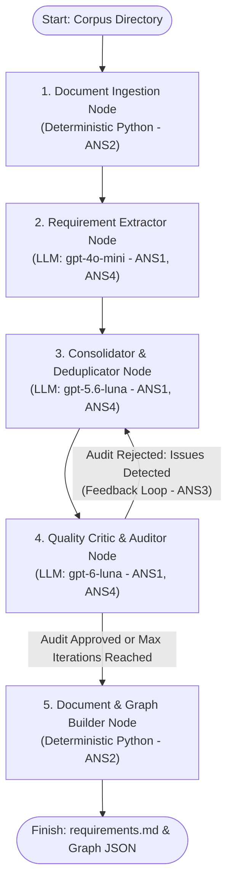

# Technical Design Report: Agentic Network for Requirements Refinement

**Project**: Software Requirements Engineering & Refinement Network  
**Target Domain**: Evergreen Integrated Library System (ILS) Requirements Consolidation  
**Framework**: Python `LangGraph` (`langgraph`, `langchain-openai`, `pydantic`)  
**Assignment**: Week 04 Requirements - Task 1  

---

## 1. Executive Summary and Architecture Overview

The objective of this project is to build an autonomous agentic network that accepts an unstructured corpus of heterogeneous software engineering documents (librarian interviews, technical subcommittee meeting minutes, email threads, and early draft specifications) and transforms them into a formal, unified, and traceable **Software Requirements Specification (SRS)**.

The network is implemented as a stateful computational graph using Python's **LangGraph** framework. It combines high-throughput parallel parsing, LLM-based extraction, semantic consolidation, and a strict, iterative **Critic feedback loop** to eliminate duplicates, resolve contradictions, enforce traceability, and isolate non-functional or discarded proposals into a blacklist.

### Agentic Network Architecture Diagram



---

## 2. Compliance with Agentic Network Specifications (ANS)

| Spec ID | Requirement Description | Implementation in Network | Verification / Evidence |
| :--- | :--- | :--- | :--- |
| **ANS1** | At least 3 agentic (LLM-invoking) nodes | 1. `extractor_node`<br>2. `consolidator_node`<br>3. `critic_node` | 3 distinct LLM execution nodes defined in `src/graph.py`. |
| **ANS2** | At least 1 deterministic (non-AI) node | 1. `ingestion_node` (RFC-compliant MIME parser & crawler)<br>2. `builder_node` (Markdown compiler & graph generator) | Pure algorithmic Python implementations with zero LLM calls. |
| **ANS3** | At least 1 feedback loop (1 node checks output of another) | `critic_node` audits the candidate specification produced by `consolidator_node`. If issues are detected, a conditional edge loops back to `consolidator_node` with actionable feedback. | In the production run, Iteration 1 yielded `Approved=False` (Score: 91/100, 2 issues). The feedback loop routed execution back to the Consolidator, which refined the dataset into Iteration 2 (Score: 94/100, Approved). |
| **ANS4** | At least 3 different LLM models | 1. `gpt-4o-mini` (High-speed document extractor)<br>2. `gpt-5.6-luna` (Advanced semantic consolidator)<br>3. `gpt-6-luna` (Deep reasoning quality auditor) | Configured in `src/config.py` and verified against the OpenAI API endpoint. |
| **ANS5** | Implemented in Python's LangGraph | Built with `StateGraph(GraphState)` using typed state dictionaries, explicit node addition, and conditional routing edges. | Compiled workflow in `src/graph.py` executed via `app.invoke()`. |

---

## 3. Node Design Choices and Model Selection Rationale

### Node 1: Ingestion & Preprocessing Node (Deterministic - ANS2)
- **Role**: Discovers all files recursively in the specified input directory. It supports both `.eml` and `.txt` files.
- **Design Choice**: E-mails are parsed using Python's standard `email` library (`email.policy.default`) to extract headers (`From`, `To`, `Subject`, `Date`) and clean body text while discarding noisy multipart MIME attachments.
- **Significance**: By standardizing all files into `DocumentItem` objects with unique filenames and clean text, it enables robust traceability downstream without token bloat.

### Node 2: Requirement Extractor Node (LLM 1: `gpt-4o-mini` - ANS1, ANS4)
- **Role**: Thoroughly extracts atomic candidate requirements from every document in the corpus.
- **Model Choice**: `gpt-4o-mini` was selected because extraction from 20 individual files requires high throughput, structured JSON schema adherence, and cost-efficiency.
- **Concurrency**: Employs a thread pool executor (`ThreadPoolExecutor(max_workers=5)`) to process the 20 documents in parallel, reducing extraction latency from ~60 seconds to ~12 seconds.
- **Result**: Extracted 252 raw candidate requirements, ensuring complete coverage (**OS8**) and recording initial file provenance (**OS4**).

### Node 3: Consolidator & Deduplicator Node (LLM 2: `gpt-5.6-luna` - ANS1, ANS4)
- **Role**: Performs global synthesis across the 252 raw extractions.
- **Model Choice**: `gpt-5.6-luna` possesses a massive context window and strong semantic reasoning capabilities, making it ideal for detecting non-obvious redundancies across disparate conversations.
- **Core Operations**:
  - **Deduplication (OS3)**: Collapses identical requests (e.g. batch item transfers mentioned in multiple emails) into a unified requirement.
  - **Traceability Preservation (OS4)**: Aggregates source files from all merged raw items into a consolidated list.
  - **Categorization & Unique IDs (OS2)**: Generates structured IDs like `REQ-CAT-001`, `REQ-CIR-001`, `REQ-REP-001`.
  - **Prioritization (OS6)**: Assigns MoSCoW rankings with architectural rationales.
  - **Blacklisting (OS9)**: Segregates out-of-scope, nonsensical, or administratively rejected statements into a separate collection.

### Node 4: Quality Critic & Auditor Node (LLM 3: `gpt-6-luna` - ANS1, ANS3, ANS4)
- **Role**: Acts as a strict Lead Quality Auditor reviewing the proposed specification against all OS1–OS9 criteria.
- **Model Choice**: `gpt-6-luna` is a deep reasoning model with internal chain-of-thought verification. It identifies subtle inconsistencies, terminology mismatches, and boundary overlaps.
- **Feedback Loop Dynamics (ANS3)**:
  - If compliance flaws are discovered and the iteration count is below `MAX_FEEDBACK_ITERATIONS`, the Critic marks `approved = False`, outlines specific defects (`issues`), and issues prescriptive advice (`suggestions`).
  - LangGraph's conditional edge router triggers a loop back to Node 3.
  - Node 3 receives the previous state along with the Critic's feedback section in its prompt, enabling targeted self-correction.

### Node 5: Document & Graph Builder Node (Deterministic - ANS2)
- **Role**: Converts the verified state into final deliverable artifacts.
- **Outputs**:
  - `requirements.md`: A 515-line Software Requirements Specification complying with all output specifications.
  - `requirements_graph.json`: A structured graph (55 nodes, 104 edges) linking source documents, prioritized requirements, and blacklisted items.

---

## 4. Compliance with Output Specifications (OS1–OS9)

Every output requirement specified in the assignment is systematically addressed in the network architecture:

| Spec ID | Requirement Description | Architectural Mechanism & Section in Output |
| :--- | :--- | :--- |
| **OS1** | Single structured document | `builder_node` compiles all data into a single comprehensive Markdown file (`requirements.md`) with a table of contents, master table, subsystem catalogs, and audit logs. |
| **OS2** | Unique identification of each requirement | Enforced by Pydantic schema validation and prompt constraints in Node 3. Generates structured identifiers prefixed by subsystem (e.g., `REQ-CAT-001`, `REQ-FIN-001`). Verified by Node 4. |
| **OS3** | No (semantically) duplicate requirements | Addressed by Node 3 prompt instructions and verified by Node 4. In Iteration 1, 41 requirements were consolidated; in Iteration 2, the Critic prompted further consolidation, refining the total to 31 unique requirements. |
| **OS4** | Tracing (provenance back to input files) | Maintained from Node 2 extraction (`source_file`), merged in Node 3 (`source_documents`), and prominently rendered in Section 2 and Section 3 of `requirements.md` (e.g. `conv_pines018_item_transfer.eml`, `early_draft_srs_galecia.txt`). |
| **OS5** | Short descriptive name and paragraph explanation | Structured in Pydantic schema (`title: str`, `description: str`). Consolidator prompt mandates 3–5 sentence functional explanations detailing behavior and edge cases. |
| **OS6** | Priority assigned + priority scale explained | MoSCoW method (`Must Have`, `Should Have`, `Could Have`, `Won't Have`) is applied to every requirement. The priority scale is comprehensively defined in Section 1.1 of `requirements.md`. |
| **OS7** | Consistency across requirements | Node 3 unifies terminology to match Evergreen ILS domain standards (patron, bibliographic record, in-transit item, home library). Node 4 specifically audits for conflicting rules. |
| **OS8** | Completeness across input documents | Node 2 processes 100% of corpus documents without selective omitting, capturing 252 raw items across circulation, cataloging, financial reporting, and system administration. |
| **OS9** | Blacklist of discarded proposals | Section 4 of `requirements.md` isolates discarded proposals (`BLK-001` through `BLK-004`). Each entry explicitly states the original proposal, originating source documents, and the engineering rationale for exclusion (e.g., project-governance actions, absent appendices). |

---

## 5. Quantitative Verification of Results

From the real execution on `data/corpus`:
- **Total Ingested Files**: 20 documents (all `.eml` and `.txt` files parsed).
- **Raw Extracted Requirements**: 252 items (`gpt-4o-mini`).
- **Consolidated Requirements**: 31 items (`gpt-5.6-luna`).
  - *Must Have*: 23 requirements (Core transactions, security, cataloging, financial integrity).
  - *Should Have*: 8 requirements (Operational dashboards, batch reporting, queueing).
- **Blacklisted / Discarded Proposals**: 4 items (`BLK-001` to `BLK-004`).
- **Feedback Loop Cycles**: 2 iterations executed.
- **Audit Quality Score**: Improved from 91/100 (Iteration 1) to **94/100 (Iteration 2 - Approved)**.
- **Graph Topology**: 55 nodes (20 documents, 31 requirements, 4 blacklisted items) and 104 provenance edges.

---

## 6. Execution Instructions

### Running the CLI Pipeline
```bash
# Activate virtual environment
source .venv/bin/activate

# Execute network on any input directory
python main.py --input data/corpus --output requirements.md
```

### Launching the Interactive Visualizer (Streamlit UI)
```bash
source .venv/bin/activate
streamlit run app.py
```
The Streamlit application includes an interactive PyVis force-directed and hierarchical graph with specialized views:
- **Agent Flow View**: Explicitly renders each individual agent as a dedicated node (`gpt-4o-mini`, `gpt-5.6-luna`, `gpt-6-luna`, Python), visualizing the multi-agent pipeline and the red dashed feedback loop.
- **Traceability View**: Direct document-to-requirement derivation mapping.
- **Pure Network Architecture View**: Minimalist topology of the 5 LangGraph nodes and conditional edges.
- **Interactive Inspector**: Inspect any requirement or agent node to view model specifications, prompts, audit logs, and source files.
- **Color Legend**: High-contrast 6-card legend explaining node semantics across light and dark display modes.
