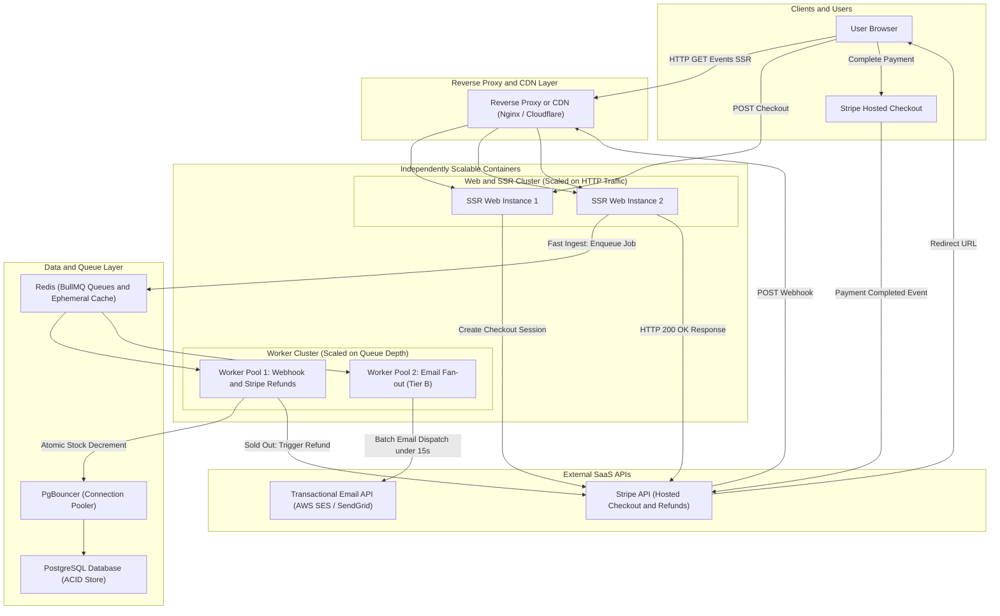
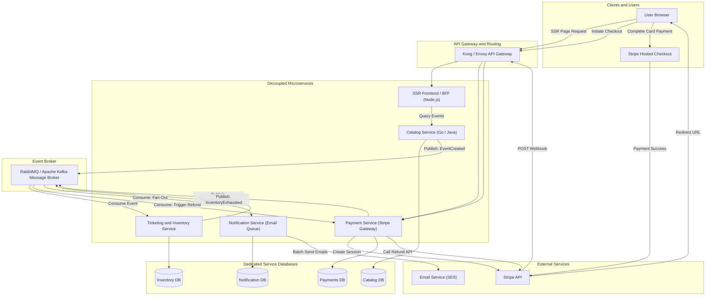
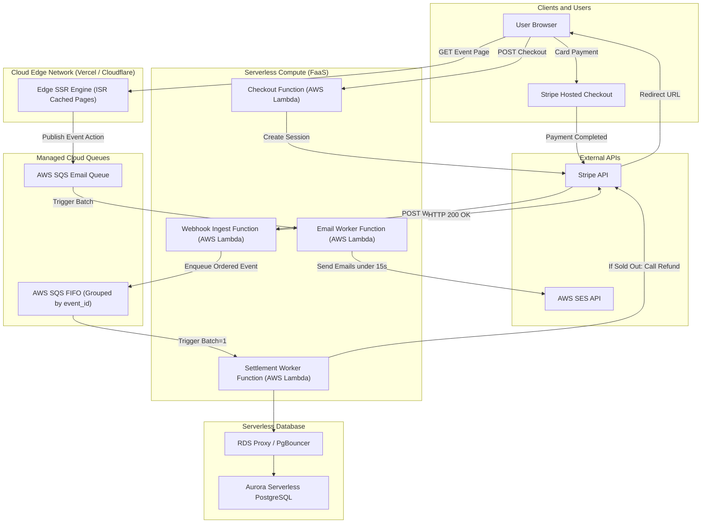

# ADR-001: Architecture Selection for EventTicket Platform

**Status:** Accepted  
**Date:** 2026-10-28  
**Author / Team:** EventTicket Core Team  
**Scope:** Core System Architecture, Component Scaling, Payment Ingestion, and Background Processing

---

## 1. Context and Problem Statement

The **EventTicket** platform is a web application providing event discovery, event proposal/management for organizers, and ticket/pre-sale distribution for customers. The platform must support distinct user roles (Clients, Registered Users, Event Managers, and System Admins) with features including category-based email notifications, ticket purchasing, and password recovery.

### Key Functional Requirements
- **Event Discovery & Exploration:** Clients and users explore events categorized by domain.
- **Event Publishing:** Managers insert new events into the catalog.
- **Ticket Purchase & Pre-Sales:** Users buy tickets or book pre-sales and receive unique ticket codes upon successful payment.
- **Category Notifications:** Users subscribe to favorite categories and receive timely email notifications when relevant events are published.
- **Access Control:** Role-based access control (RBAC) across Client, User, Manager, and Admin roles.

### Decision Drivers & Quality Attributes
1. **Team Size:** A **small team** will build and operate the application; infrastructure and operational maintenance must remain minimal.
2. **Component Scaling:** Components must **scale independently** (frontend rendering, payment webhook reconciliation, and background email dispatch must not bottleneck each other).
3. **Application Type:** **Server-Side Rendered (SSR)** for SEO optimization, fast First Contentful Paint (FCP), and unified authentication state.
4. **Budget & Availability:** **Tier A Availability (99.0% uptime)** — Cost-effective single-region deployment, automated process restarts, and daily automated backups (RTO ~1–2 hours).
5. **Traffic & Concurrency:** **Tier B Concurrency (500–2,000 burst users)** — Rapid traffic surges during high-demand event ticket drops.
6. **Payment Processing & Security:** **Tier A Hosted Checkout (Stripe Checkout / PayPal Hosted)** — Zero credit card handling on application servers (PCI-DSS SAQ A compliance).
7. **Inventory & Checkout Strategy:** **"First-to-Pay-Wins"** — No pre-checkout inventory locking; stock is decremented upon payment confirmation, with automatic instant refunds triggered for over-subscribed buyers.
8. **Notification Delivery:** **Tier B Speed (< 15 seconds)** — Asynchronous queue-backed email dispatch to all category subscribers upon event publication.

---

## 2. Detailed Explanation and Visualization of Candidate Architectures

To make an informed and rigorous decision, we thoroughly analyzed three distinct architectural styles against our project constraints.

---

### 2.1. Option 1: Multi-Process Modular Monolith with Worker Decoupling (Selected)

#### How It Works:
- **Codebase Organization:** The application is maintained in a single repository with strict internal modular boundaries (`auth`, `catalog`, `ticketing`, `payment`, `notifications`). All modules share domain models and a unified schema in a single PostgreSQL database.
- **Independent Component Scaling:** While the codebase is unified, it is built as a single container image and deployed as **two independently scalable process workloads**:
  1. **`Web / SSR Container`:** Runs the SSR web application (Next.js / Node.js) and public REST endpoints. It renders server-side pages, serves cached event catalogs, creates external Stripe checkout sessions, and ingests inbound Stripe webhooks. During ticket drops, this container scales horizontally (e.g., 2–4 instances) to handle high HTTP traffic.
  2. **`Async Worker Container`:** Dedicated exclusively to background jobs using Redis and an asynchronous job manager (BullMQ / Celery). It runs two isolated worker pools: one dedicated to critical payment webhook reconciliation and automated refunds, and a second dedicated to high-volume category email fan-out.
- **Flash-Sale Workflow ("First-to-Pay-Wins"):**
  1. Users browse event pages (cached at the reverse proxy/CDN).
  2. 500 users click "Buy" for 50 tickets; the Web service creates 500 Stripe sessions without locking stock.
  3. When payments complete, Stripe webhooks hit the Web service, which validates signatures and pushes tasks into Redis in < 2ms, immediately returning `HTTP 200 OK` to Stripe.
  4. The Worker container pulls jobs from Redis sequentially per event and executes an atomic SQL decrement in PostgreSQL.
  5. The first 50 jobs decrement stock and issue ticket codes. The remaining 450 jobs detect `remaining_tickets == 0` and immediately call the Stripe Refund API.
- **Notification Fan-out (< 15s):** When a manager posts an event, an event publication job is pushed to Redis. The worker streams subscriber IDs in 500-user chunks and dispatches batch API requests to the email provider in parallel threads.

#### Visual Architecture Diagram (Option 1):


---

### 2.2. Option 2: Event-Driven Microservices

#### How It Works:
- **Codebase Organization:** The system is split into multiple distinct, decoupled microservices, each with its own codebase, deployment pipeline, and private database:
  1. `SSR Frontend / BFF Service`: Renders HTML and aggregates data from downstream services.
  2. `Event Catalog Service`: Manages event listings, categories, and manager submissions (owns `catalog_db`).
  3. `Ticketing & Inventory Service`: Manages real-time ticket stock and ticket code generation (owns `inventory_db`).
  4. `Payment Service`: Interfaces with Stripe, ingests webhooks, and manages transaction records (owns `payments_db`).
  5. `Notification Service`: Manages user category subscriptions and dispatches emails (owns `notifications_db`).
- **Inter-Service Communication:** Services communicate asynchronously via an enterprise message broker (RabbitMQ or Apache Kafka) for state transitions, and synchronously via gRPC/REST for UI data queries.
- **Flash-Sale Workflow ("First-to-Pay-Wins"):**
  1. When Stripe completes payment, the webhook hits the `Payment Service`.
  2. `Payment Service` records payment and publishes a `PaymentCompleted` domain event to the message broker.
  3. The `Ticketing Service` consumes the event from an event-partitioned queue (ensuring serialized processing per `event_id`).
  4. If stock is available, it decrements inventory and publishes `TicketIssued`.
  5. If stock is depleted, it publishes `InventoryExhausted`.
  6. The `Payment Service` listens for `InventoryExhausted` and calls the Stripe Refund API (Saga Choreography Pattern).
- **Why Rejected:**
  - **Crushing DevOps Burden:** Managing 5 CI/CD pipelines, container registries, service meshes, distributed logging, and independent database backups is not sustainable for a **small team**.
  - **Distributed Consistency Overhead:** Handling edge cases (e.g., network timeout during refund message delivery) requires complex dead-letter queues (DLQs) and distributed compensation transactions.

#### Visual Architecture Diagram (Option 2):


---

### 2.3. Option 3: Cloud-Native Serverless SSR (PaaS / FaaS)

#### How It Works:
- **Codebase Organization:** Built using a modern fullstack serverless framework (e.g., Next.js deployed on Vercel or AWS Amplify / Cloud Run).
- **Infrastructure Components:**
  1. **Edge SSR Network:** Pages are rendered on edge nodes distributed globally and cached using Incremental Static Regeneration (ISR).
  2. **API Functions (FaaS):** Stateless serverless functions (AWS Lambda or Google Cloud Functions) execute HTTP handlers on demand.
  3. **Cloud Message Queuing:** AWS SQS FIFO queues buffer incoming Stripe webhooks with message grouping keyed by `event_id` to guarantee strictly ordered execution without race conditions.
  4. **Serverless Relational Database:** Managed auto-scaling PostgreSQL (e.g., Neon, Supabase, or AWS Aurora Serverless v2).
  5. **Worker Functions:** Queue-triggered Lambda functions process ticket decrement and email dispatch.
- **Flash-Sale Workflow ("First-to-Pay-Wins"):**
  1. Edge CDN serves cached event browsing pages.
  2. Users pay on Stripe; Stripe webhooks hit the serverless Webhook Ingestion Function.
  3. The function writes messages to an **AWS SQS FIFO Queue** where `MessageGroupId = event_id`.
  4. SQS triggers the Settlement Worker Lambda with concurrency set to 1 per message group, ensuring sequential stock checks.
  5. If tickets remain, stock is decremented; if depleted, the Lambda invokes Stripe's refund endpoint.
- **Why Deferred:**
  - **Cold Start Latency:** Flash sales create sudden massive spikes in function invocations; cold starts (500ms–1.5s) can introduce unpredictable latency at the critical moment of ticket release.
  - **Connection Exhaustion:** Hundreds of concurrent Lambdas connecting to PostgreSQL can exhaust connection pools unless complex, costly connection proxy layers (e.g., AWS RDS Proxy) are introduced.
  - **Vendor Lock-in & Testing Complexity:** Emulating SQS FIFO, Lambda triggers, and edge runtimes locally is notoriously tedious for a small team compared to Docker Compose.

#### Visual Architecture Diagram (Option 3):


---

## 3. Architecture Comparison Matrix

| Evaluation Criteria | Option 1: Multi-Process Monolith (Selected) | Option 2: Event-Driven Microservices | Option 3: Cloud-Native Serverless SSR |
|---|---|---|---|
| **Independent Component Scaling** | **High** (Web and Worker containers scale on different triggers) | **Very High** (Each microservice auto-scales independently) | **Very High** (Functions scale dynamically from 0 to thousands) |
| **Operational Overhead (Small Team)** | **Lowest** (1 codebase, 1 database, unified CI/CD, simple Docker Compose) | **Highest** (5 repos/services, message brokers, service meshes) | **Medium** (Cloud provider configurations, IAM policies, emulators) |
| **Flash-Sale Burst Handling** | **High** (In-memory Redis ingestion + PgBouncer connection pooling) | **High** (Partitioned message queues with dedicated workers) | **Medium-Low** (Cold starts, DB connection pressure, SQS FIFO limits) |
| **Development & Debugging Simplicity** | **Highest** (Run full stack locally with one `docker compose up`) | **Lowest** (Mocking downstream services, complex distributed tracing) | **Medium** (Local serverless emulators frequently differ from cloud) |
| **Infrastructure Cost at Baseline** | **Low** (Single modest VPS or container cluster fits Tier A budget) | **High** (Substantial fixed overhead for running 5+ services and brokers) | **Pay-As-You-Go** (Near-zero at idle, but charges surge under bursts) |
| **Data Consistency & Transactions** | **ACID** (Native relational transactions, atomic SQL decrements) | **Eventual Consistency** (Requires Saga compensation orchestrators) | **ACID** (Relational, but requires strict proxy connection handling) |

---

## 4. Decision Outcome and Final Implementation Architecture

**Selected Decision:** **Option 1: Multi-Process Modular Monolith with Asynchronous Worker Decoupling**

We adopt Option 1 because it satisfies every project requirement without unnecessary complexity:
1. **Solves Independent Scaling:** The `SSR Web Container` (scaled on HTTP requests) and the `Worker Container` (scaled on Redis queue depth) scale independently.
2. **Protects the Small Team:** Eliminates microservice operational fatigue; all code resides in one repository with shared types, models, and migrations.
3. **Guarantees Correctness under "First-to-Pay-Wins":** Combines fast in-memory Redis webhook buffering with atomic PostgreSQL SQL updates to ensure tickets can never be double-sold.

---

## 5. Low-Level Implementation Protocols

### 5.1. Concurrency & "First-to-Pay-Wins" Settlement Loop
To handle 500–2,000 concurrent users without pre-locking tickets and avoiding database deadlocks:
1. **Non-blocking Stripe Session Creation:** When a user initiates checkout, the `Web Service` creates a Stripe Checkout session without modifying ticket quotas.
2. **Immediate Webhook Acknowledgment:** When Stripe posts `checkout.session.completed`, the `Web Service` validates the HMAC signature, pushes the payload to the Redis `ticket-settlement` queue, and immediately returns `HTTP 200 OK` (within < 50ms).
3. **Atomic Decrement in Worker:** The `Worker Service` consumes the settlement job and executes a single atomic SQL transaction:
   ```sql
   UPDATE events 
   SET remaining_tickets = remaining_tickets - :requested_qty,
       version = version + 1
   WHERE id = :event_id AND remaining_tickets >= :requested_qty
   RETURNING id;
   ```
4. **Resolution Branching:**
   * **Success (`RETURNING id` matches):** Unique ticket code is generated and saved in `tickets` table; a confirmation email job is pushed to the notification queue.
   * **Failure (0 rows updated - Event Sold Out):** The event is depleted. The worker immediately executes:
     ```python
     stripe.Refund.create(
         payment_intent=session.payment_intent,
         reason="requested_by_customer",
         metadata={"system_reason": "sold_out_reconciliation"}
     )
     ```
     An automated notification job is queued informing the user that the event was sold out and their payment has been refunded.

### 5.2. Tier B Notification Fan-Out (< 15 Seconds)
1. When a manager posts a new event, an `event-published` job containing `category_id` and `event_id` is dispatched to Redis.
2. The notification worker queries user IDs subscribed to `category_id` in streaming batches (cursor-based pagination of 500 users).
3. Jobs are parallelized across worker concurrency threads, utilizing the email provider’s batch dispatch API (e.g., AWS SES `SendBulkTemplatedEmail` or SendGrid Batch API) ensuring 2,000+ emails are transmitted in under 15 seconds while respecting provider rate limits (e.g., 50–100 requests/sec).

### 5.3. SSR Performance Under Flash Sales
1. Event discovery pages utilize **Incremental Static Regeneration (ISR)** or edge CDN caching with short stale-while-revalidate TTLs (e.g., `s-maxage=5, stale-while-revalidate=10`).
2. This protects the SSR Node.js runtime from rendering 2,000 dynamic HTML pages simultaneously during a ticket drop.

---

## 6. Consequences and Trade-offs

### Positive Consequences
* **Extreme Developer Velocity:** The small team operates in a single repository with shared TypeScript/Python models, unified migrations, and single-command local setup via Docker Compose.
* **True Independent Scalability:** The `Web/SSR` service can scale independently to handle traffic spikes, while the `Worker` service scales independently to process queue backlogs without starving HTTP threads.
* **Rock-Solid Consistency:** A single relational database prevents overselling via native atomic checks without distributed saga orchestrators.
* **Cost Efficiency:** Meets the Tier A availability budget requirement (~99.0% uptime) with minimal baseline cloud costs.

### Negative Consequences & Mitigations
* **Payment Processing Fee Losses on Refunds:**
  * *Risk:* Stripe does not return processing fees on refunded transactions. A burst of 200 failed purchases incurs real fee losses.
  * *Mitigation:* The frontend will display real-time approximate ticket counts via lightweight server-sent events (SSE) or short polling, disabling the "Buy" button once stock nears zero to minimize late checkout attempts.
* **Database Connection Saturation:**
  * *Risk:* Scaling the web instances during a flash sale could overwhelm PostgreSQL connection limits.
  * *Mitigation:* Mandatory deployment of **PgBouncer** in transaction pooling mode between the compute containers and the PostgreSQL database.
