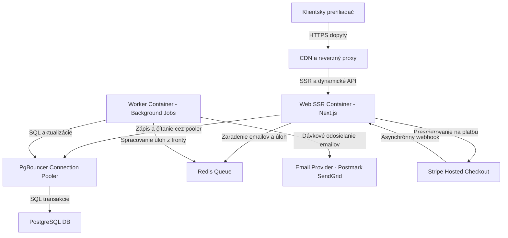
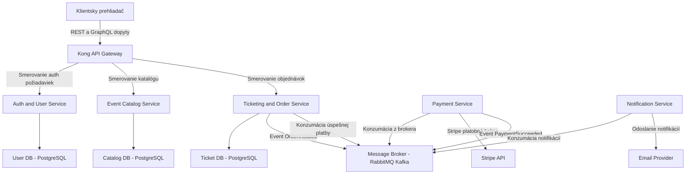
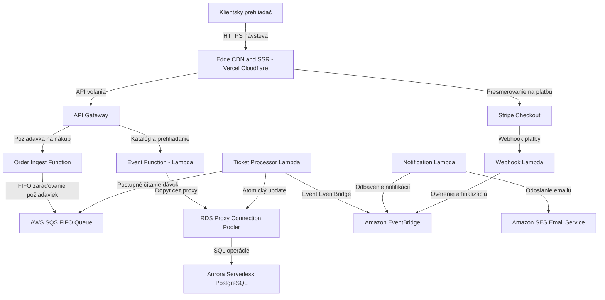

# Conversation Record: Task 1 - EventTicket Architecture Exploration (Skill-Assisted)
**Dátum:** 2026-10-28  
**Projekt:** EventTicket  
**Kontext:** Návrh troch architektonických riešení, NFR Discovery a hĺbková analýza low-level rizík na základe `EventTicket.txt`.

---

## 1. Priebežné architektonické poznámky (Running Notes)

Poznámky sú priebežne aktualizované v súbore `architecture_notes.md`.

---

## 2. Analýza funkčných požiadaviek (Requirements Ingestion)

Zo špecifikácie `EventTicket.txt` boli identifikované nasledujúce kľúčové prvky:
- **Roly:**
  - **Client (Anonymný návštevník):** Prezeranie stránky a zoznamu podujatí, registrácia, prihlásenie.
  - **User (Registrovaný zákazník):** Profil, voľba obľúbených kategórií pre emailové notifikácie, rezervácia predpredajov, nákup lístkov a online platba s obdržaním kódu lístka, obnova hesla.
  - **Manager (Organizátor):** Vlastný profil, vytváranie a publikovanie podujatí (čo spúšťa notifikáciu odberateľom kategórie), sledovanie navrhnutých podujatí.
  - **Admin (Administrátor):** Správa a autorizácia manažérov na publikovanie podujatí.
- **Kritické miesta zlyhania:**
  - Konkurenčný nákup (flash-sale surge) a riziko prepredania lístkov.
  - Asynchrónne platby, webhook timeouty a nevratné poplatky platobných brán.
  - Fan-out emailových notifikácií pri vytvorení podujatia obľúbenej kategórie.
  - Zahltenie databázových spojení pri náhlych dopravných špičkách.

---

## 3. Návrh 3 kvalitatívne odlišných architektonických paradigiem

### Návrh 1: Multi-Process Modular Monolith (Pragmatic / Decoupled Worker)
- **Štrukturálny princíp:** Jediný repozitár a unifikovaný kód rozdelený do čistých modulov (Auth, Catalog, Ticketing, Payment, Notification). Aplikácia beží v dvoch samostatných typoch kontajnerov:
  1. *Web / SSR proces (Node.js/Next.js):* Rýchle servovanie stránok, API endpointy, Stripe Checkout presmerovanie, webhook ingest.
  2. *Worker proces (BullMQ / Celery):* Asynchrónne úlohy na pozadí čerpané z Redis fronty (dávkové odosielanie emailov, generovanie QR lístkov, refund kompenzácie).
- **Riešenie konkurencie & stavu:** Centralizovaná PostgreSQL databáza za PgBouncer poolerom. Predaj lístkov je chránený atomickým SQL podmieneným updatom:
  ```sql
  UPDATE events 
  SET remaining_tickets = remaining_tickets - :qty,
      version = version + 1
  WHERE id = :event_id AND remaining_tickets >= :qty
  RETURNING id;
  ```
- **Rozpočtový & Prevádzkový profil:** Tier A / B. Extrémne ekonomické riešenie (~20–60 € / mesiac na VPS alebo PaaS ako Render/Railway/Fly.io). Žiadna nutnosť Kubernetes, vhodné pre tím 1–3 vývojárov.
- **Low-level implementačné bolesti:**
  - Potreba prísnej konfigurácie `transaction` módu v PgBounceri.
  - Vertikálny I/O limit databázy pri extrémnych špičkách bez implementácie read-replík.



---

### Návrh 2: Event-Driven Microservices (Enterprise / Plne distribuovaný)
- **Štrukturálny princíp:** Autonómne mikroslužby podľa biznis domén (Auth Service, Catalog Service, Ticketing & Order Service, Payment Gateway Service, Notification Service), pričom každá vlastní svoju vlastnú databázu (Database-per-Service). Vstup zabezpečuje API Gateway (Kong/Traefik). Medzislužbová komunikácia prebieha cez asynchrónny message broker (RabbitMQ alebo Apache Kafka).
- **Riešenie konkurencie & stavu:** Eventuálna konzistencia riadená pomocou Saga Patternu (Orchestrácia alebo Choreografia). Nákup lístka zahŕňa viacfázový distribuovaný proces: dočasná rezervácia slotu v Ticketing Service -> iniciácia platby v Payment Service -> potvrdenie webhooku -> emitovanie `PaymentSucceeded` -> generovanie lístka v Ticketing Service -> notifikácia cez Notification Service.
- **Rozpočtový & Prevádzkový profil:** Tier C / Enterprise. Vysoké náklady na infraštruktúru (~300–1000+ € / mesiac), vyžaduje Kubernetes cluster (EKS/GKE), centralizovaný logging (ELK stack) a distribuované trasovanie (OpenTelemetry / Jaeger).
- **Low-level implementačné bolesti:**
  - Problém Dual-Write vyžaduje Transactional Outbox Pattern a CDC nástroje (Debezium).
  - Riešenie zlyhaní kompenzácií (Saga rollback) a uvoľňovanie visiacich (zombie) rezervácií.
  - Netriviálny debugging a vysoká komplexita pre malý tím.



---

### Návrh 3: Cloud-Native Serverless SSR (PaaS / FaaS)
- **Štrukturálny princíp:** Plne bezserverová architektúra. Frontend je renderovaný na Edge CDN (Vercel / Cloudflare Pages) pre okamžitú globálnu odozvu. Backend pozostáva z izolovaných FaaS funkcií (AWS Lambda) riadených cez API Gateway. Dáta sú uložené v manažovanej bezserverovej PostgreSQL databáze (Aurora Serverless / Neon) chránenej cez RDS Proxy.
- **Riešenie konkurencie & stavu:** Nákupné požiadavky počas špičiek (drops) sa radia do **AWS SQS FIFO fronty**, kde atribút `MessageGroupId=event_id` garantuje striktné spracovanie nákupov sekvenčne po jednom. Tým sa úplne eliminuje riziko race conditions v databáze bez potreby distribuovaných zámkov.
- **Rozpočtový & Prevádzkový profil:** Pay-per-use (Tier A/B pri bežnej prevádzke). Minimálne fixné náklady v čase nečinnosti, dynamický nárast počas veľkých predajov. Žiadna správa OS a serverových inštancií.
- **Low-level implementačné bolesti:**
  - **Cold Starts:** Latencia Lambda funkcií (500 ms – 2 000 ms) pri náhlom návale na neaktívne funkcie.
  - **Connection Storms:** Riziko vyčerpania DB spojení pri paralelnom štarte stoviek Lambd bez RDS Proxy.
  - Silný Vendor Lock-in na AWS/Cloudflare ekosystém a zložitejšie lokálne testovanie.



---

## 4. Matica nefunkčných požiadaviek (Budget-Aligned NFR Discovery)

| NFR Dimenzia | Tier A (Lean / Budget) | Tier B (Balanced / Growth) | Tier C (High Scale / Enterprise) |
|---|---|---|---|
| **Dostupnosť (Uptime)** | **99.0%** (1 zóna, auto-restart kontajnera, denné zálohy, RTO 1-2h) | **99.9%** (Multi-AZ failover, point-in-time recovery DB) | **99.99%** (Multi-region active-active, zero-downtime deploy) |
| **Záťaž & Konkurencia** | Stabilná malá záťaž (<100 súbežných nákupov, DB row lock) | Návalové dropy (500–2,000 používateľov, PgBouncer, Redis fronty, CDN keš) | Masívne flash-sales (10,000+ používateľov, virtuálna čakáreň / FIFO tokeny) |
| **Platby & Bezpečnosť** | Hosted Checkout (Stripe Checkout / PCI SAQ A, nulová réžia kariet) | Embedded Elements (Vlastné UX na stránke, tokenizácia cez Stripe Elements) | Vlastný payment processing (Plná PCI-DSS Level 1 certifikácia) |
| **Notifikácie** | Dávkové asynchrónne odosielanie (doručenie do 1-5 min) | Rýchle doručenie (<15 sekúnd, dedikovaný worker, retry logika) | Okamžitý real-time stream + SMS a Push notifikácie |
| **Tím & Prevádzka** | 1–3 vývojári (jednoduchý monorepo, Docker Compose / PaaS) | Malý tím (3-6 vývojárov) s 1 DevOps inžinierom | Plnohodnotný 24/7 SRE / Platform tím |

---

## 5. Low-Level Mechanics & Concurrency Deep-Dive

### 5.1 Stratégia inventára pri externých platbách: Soft-Lock vs. First-to-Pay-Wins
- **Soft-Lock s TTL (10 minút):**
  - Pri kliknutí "Kúpiť lístok" systém overí voľnú kapacitu a vytvorí dočasnú rezerváciu so stavom `PENDING` a časom expirácie.
  - Ak používateľ dokončí platbu na Stripe do 10 minút, stav sa zmení na `CONFIRMED` a vygeneruje sa kód lístka.
  - Ak zákazník okno zatvorí alebo nezaplatí, automatický cron/worker uvoľní lístok späť do predaja.
- **First-to-Pay-Wins (Optimistický prístup):**
  - Lístok sa vopred nerezervuje. Všetci záujemcovia sú presmerovaní na Stripe Checkout.
  - Kto ako prvý zaplatí a jeho webhook dorazí do backendu, tomu atomický SQL dotaz priradí lístok.
- **Riziko First-to-Pay-Wins a poplatky Stripe:**
  - Platobné brány (napr. Stripe) **nevracajú transakčný poplatok (2.9% + 0.30 €)** pri vrátení peňazí (refund)!
  - Ak je k dispozícii 50 lístkov a 250 zákazníkov naraz zaplatí cez Stripe, 200 zákazníkom musí byť vrátená plná suma, no poplatky platobnej bráne uhradí prevádzkovateľ systému. To by pri 200 prepredaných lístkoch znamenalo čistú stratu stoviek eur za niekoľko sekúnd.
  - **Záver:** Pre vstupenkový systém je podstatne bezpečnejší **Soft-Lock s TTL** alebo atomický update pred inicializáciou platby.

### 5.2 Atomický SQL Update Pattern
Aby nedošlo k race condition a prepredaju pri paralelnom spracovaní požiadaviek, databáza využíva atomickú podmienku v príkaze UPDATE:
```sql
UPDATE events 
SET remaining_tickets = remaining_tickets - :qty,
    version = version + 1
WHERE id = :event_id AND remaining_tickets >= :qty
RETURNING id;
```
Ak dotaz vráti ID riadku, nákup bol úspešne alokovaný. Ak vráti 0 riadkov, lístky sú vypredané a transakcia je bezpečne odmietnutá.

### 5.3 Notifikačný Fan-Out & Rate Limiting
- Používateľský príbeh 6 a 14: Keď manažér publikuje podujatie, všetci používatelia s touto obľúbenou kategóriou musia dostať notifikáciu.
- Ak má kategória napr. 5 000 odberateľov, odoslanie nesmie zablokovať HTTP požiadavku manažéra.
- **Implementácia:**
  1. Webový proces vytvorí podujatie a zaradí do Redis fronty jednu riadiacu správu `fanout_event_created(event_id, category_id)`.
  2. Worker vytiahne zoznam odberateľov po dávkach (chunks po 500 ID).
  3. Worker streamuje požiadavky na API emailového poskytovateľa s rešpektovaním rate-limitov (napr. 50–100 requestov za sekundu), čo zabezpečí splnenie cieľa doručenia do 15 sekúnd bez zlyhania na SMTP/API kvótach.
