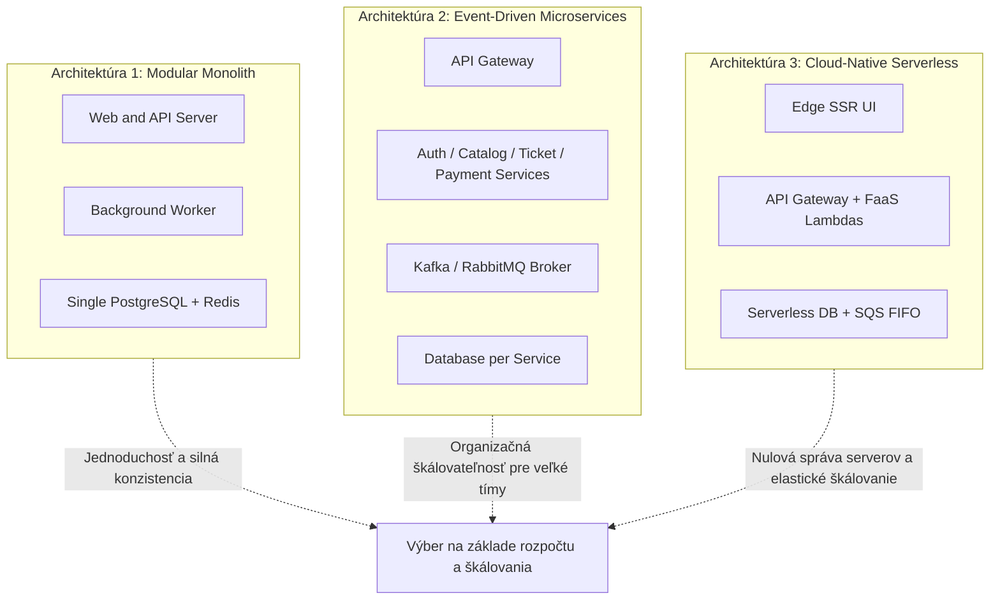
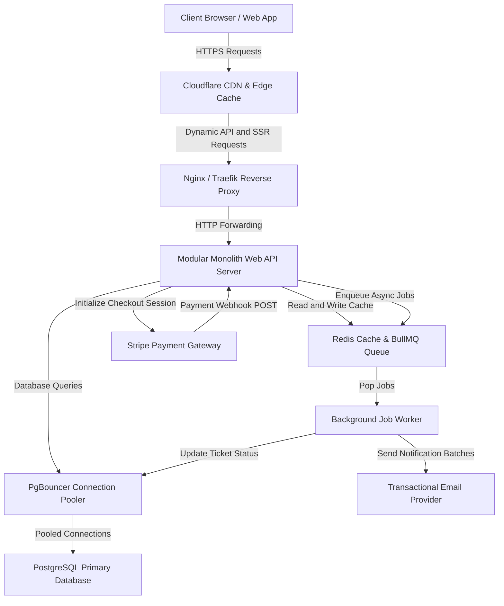
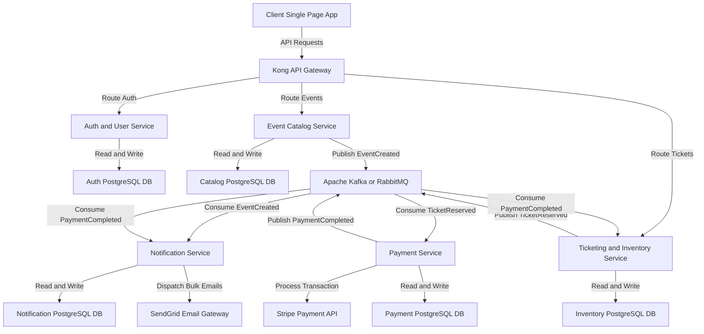
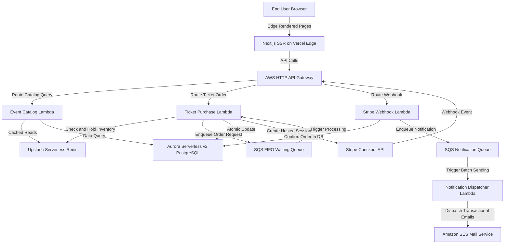
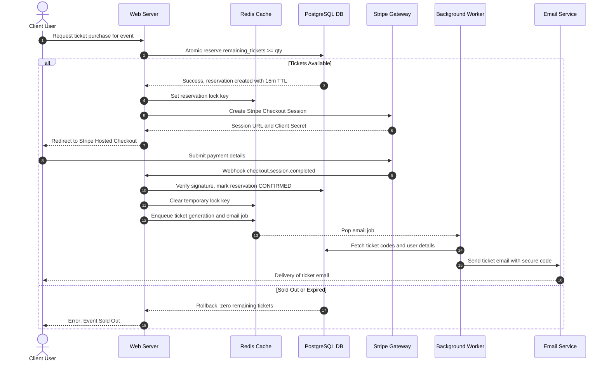

# Architektonický návrh a rozhodovací záznam (ADR) pre EventTicket

Tento dokument bol vygenerovaný metodikou riadenou zručnosťou `/architecture` na základe požiadaviek definovaných v špecifikácii `EventTicket.txt`. Obsahuje kompletnú analýzu požiadaviek, návrh 3 kvalitatívne odlišných architektonických paradigiem, rozpočtovo orientovanú NFR kategorizáciu (Tier A / B / C), hĺbkovú analýzu low-level implementačných rizík a formálny Architecture Decision Record (ADR) podľa štandardu MADR s validovanými Mermaid diagramami.

---

## 1. Analýza požiadaviek systému (Ingestion & Scope)

### 1.1 Roly a prístupové práva (RBAC)
1. **Návštevník / Anonymný klient (Client):**
   - Prehliadanie verejného zoznamu podujatí a ich detailov.
   - Registrácia nového používateľského účtu a prihlásenie (autentifikácia).
2. **Registrovaný používateľ (User):**
   - Prístup k vlastnému profilu / osobnej stránke.
   - Nastavenie preferovaných kategórií podujatí (favourite categories) pre odber notifikácií.
   - Rezervácia vstupeniek v predpredaji (pre-sale booking).
   - Nákup a online platba za vstupenky s vygenerovaním unikátneho kódu vstupenky (ticket code).
   - Prezeranie histórie zakúpených vstupeniek a aktívnych predpredajových rezervácií.
   - Obnova zabudnutého hesla (self-service password reset).
3. **Manažér podujatí (Manager):**
   - Vytváranie a publikácia nových podujatí do systému.
   - Správa a prehľad všetkých vlastných podujatí.
   - Nastavenie predaja a kapacít vstupeniek.
4. **Administrátor (Admin):**
   - Schvaľovanie a vytváranie manažérskych účtov.
   - Globálny dohľad nad používateľmi a systémovými konfiguráciami.

### 1.2 Kritické biznis toky a technické výzvy
- **Konkurenčný nákup a predpredaj vstupeniek:** Riziko prepredaja (overselling / double-booking) pri nárazovom otvorení predaja populárneho podujatia (flash drops).
- **Platobný cyklus a asynchrónne spracovanie:** Koordinácia medzi interným stavom objednávky a externou platobnou bránou (napr. Stripe Checkout). Ochrana pred stratou peňazí kvôli nevratným transakčným poplatkom brány pri zlyhaní rezervácie.
- **Notifikačný fan-out:** Pri publikácii podujatia vzniká požiadavka odoslať notifikačné e-maily všetkým používateľom so zodpovedajúcou obľúbenou kategóriou. Náhly vznik tisícok e-mailov nesmie zablokovať HTTP požiadavku manažéra ani viesť k penalizácii (throttlingu) zo strany SMTP providera.

---

## 2. Návrh 3 kvalitatívne odlišných architektonických paradigiem

Nasledujúce tri alternatívy predstavujú fundamentálne odlišné prístupy k organizácii kódu, riadeniu stavu, infraštruktúrnej prevádzke a škálovaniu.



---

### Kandidát 1: Multi-Process Modular Monolith (Pragmatický decoupled worker model)

#### Štrukturálny princíp
Jediný kódový repozitár (Monorepo) rozdelený na prísne ohraničené logické moduly podľa domény: `Auth`, `Catalog`, `Ticketing`, `Payment`, `Notification`. Systém beží v dvoch oddelených typoch procesov v kontajneroch:
1. **Web/SSR Proces:** Obsluhuje prichádzajúce HTTP požiadavky používateľov, vykresľuje stránky alebo servuje REST/GraphQL API. Nevykonáva žiadne dlhotrvajúce operácie.
2. **Worker Proces:** Beží na pozadí, vyberá asynchrónne úlohy z fronty v Redise (napr. BullMQ) a paralelne spracováva e-mailový fan-out, čistenie expirovaných rezervácií a generovanie lístkov.

Dátovú vrstvu tvorí jediná relačná databáza **PostgreSQL** s connection poolerom **PgBouncer** a in-memory store **Redis** slúžiaci ako distribuovaná cache a front úloh.



#### Riešenie konkurencie a stavu
- Využíva **striktnú ACID transakčnú sémantiku** PostgreSQL.
- Rezervácie a nákupy prebiehajú cez atomické SQL príkazy s podmienkou na zostatok (`UPDATE ... WHERE remaining_tickets >= :qty RETURNING id`) alebo pesimistické riadkové zámky (`SELECT ... FOR UPDATE`).
- Dočasná rezervácia lístka (soft-lock s TTL 10–15 minút) sa ukladá buď priamo do DB s časovou pečiatkou `reserved_until`, alebo do Redisu s automatickou expiráciou kľúča.
- Webhook z platobnej brány (`checkout.session.completed`) je idempotentný vďaka unikátnemu indexu na `payment_intent_id`.

#### Rozpočtový a prevádzkový profil
- **Náklady:** Veľmi nízke (Tier A / B). Celé riešenie je možné prevádzkovať na jedinom alebo dvoch VPS (napr. Hetzner, DigitalOcean) za 20 – 60 € mesačne s Docker Compose.
- **Tímová réžia:** Minimálna. Nevyžaduje dedikovaného DevOps inžiniera ani správu zložitého klastra. Lokálny vývoj je plne funkčný cez jeden príkaz `docker compose up`.

#### Low-level implementačné riziká a úskalia
- **Connection Exhaustion:** Ak by Web proces pri návale návštevníkov vyčerpal limit PostgreSQL spojení, databáza začne odmietať požiadavky. Je nevyhnutné predradiť PgBouncer v režime `transaction pooling`.
- **E-mailový Fan-out blokujúci I/O:** Vytvorenie podujatia nesmie iterovať zoznam používateľov synchrónne v HTTP vlákne. Musí len vložiť ID podujatia do Redis fronty.
- **Skrytá závislosť modulov:** Riziko, že vývojári v monolite začnú krížiť SQL dotazy a obchádzať rozhrania modulov, čo sťaží prípadné budúce oddelenie služieb.

---

### Kandidát 2: Event-Driven Microservices (Distribuovaná choreografia a orchestrácia)

#### Štrukturálny princíp
Aplikácia je dekomponovaná na 5 plne autonómnych mikroslužieb:
1. `Auth & User Service` (správa identít, RBAC, obnova hesla).
2. `Event Catalog Service` (vytváranie a prehľad podujatí manažérmi a klientmi).
3. `Ticketing & Inventory Service` (inventár lístkov, rezervácie predpredaja, zámky).
4. `Payment Service` (komunikácia s platobnou bránou, webhooks, audit platieb).
5. `Notification Service` (správa kategórií, šablóny, odosielanie e-mailov).

Každá mikroslužba vlastní svoju vlastnú databázu (**Database-per-Service**). Všetka medzislužobná komunikácia je asynchrónna cez message broker (**Apache Kafka** alebo **RabbitMQ**), s výnimkou synchrónnych dopytov z API Gateway (napr. Kong / Envoy).



#### Riešenie konkurencie a stavu
- **Eventual Consistency:** Neexistuje globálna ACID transakcia naprieč službami.
- Transakcie nákupu lístkov sa riadia distribuovaným vzorom **Saga** (Choreography alebo Orchestrator).
- **Outbox Pattern:** Na zaistenie spoľahlivého zápisu do databázy a odoslania správy do brokera musí každá služba ukladať udalosti do `outbox` tabuľky v rámci lokálnej transakcie, odkiaľ ich polluje Debezium / CDC konektor.
- Ak platba zlyhá, `PaymentService` publikuje udalosť `PaymentFailed`, na ktorú `InventoryService` reaguje kompenzačnou transakciou (uvoľnením rezervovaných miest).

#### Rozpočtový a prevádzkový profil
- **Náklady:** Vysoké (Tier C Enterprise). Vyžaduje Kubernetes klaster (EKS/GKE), manažovaný message broker (napr. Confluent Kafka / Amazon MSK), distribuovaný tracing (OpenTelemetry + Jaeger), Prometheus + Grafana a centralizovaný log management (Elasticsearch).
- **Tímová réžia:** Vyžaduje minimálne 1–2 skúsených SRE/DevOps inžinierov a tím 5+ vývojárov schopných spravovať distribuované zlyhania a schémy udalostí.

#### Low-level implementačné riziká a úskalia
- **Zložité riešenie zlyhaní (Saga Failures):** Kompenzačná transakcia môže sama zlyhať (napr. výpadok siete pri uvoľňovaní lístka), čo vyžaduje dead-letter queues (DLQ) a manuálne operátorské zásahy.
- **Idempotencia na každom kroku:** Správy v Kafke majú garanciu `at-least-once`. Každý konzument musí evidovať `processed_message_id`, inak hrozí dvojitý nákup alebo duplicitné odoslanie e-mailov.
- **Latencia a UI odozva:** Používateľ na frontende musí čakať na asynchrónne potvrdenie cez WebSockety / Server-Sent Events, kým sa sága dokončí.

---

### Kandidát 3: Cloud-Native Serverless & Edge SSR Architecture

#### Štrukturálny princíp
Prezentácia a server-side rendering sú umiestnené na Edge sieti (napr. Next.js na Vercel alebo Cloudflare Workers). Backendová logika beží ako bezstavové cloudové funkcie (**AWS Lambda** alebo **Google Cloud Run**) riadené cez API Gateway.
- Dáta sú uložené v bezserverovej relačnej databáze (**AWS Aurora Serverless v2** alebo **Neon PostgreSQL**) s podporou HTTP poolingu.
- Nákupné požiadavky sa zaraďujú do **AWS SQS FIFO** fronty, ktorá funguje ako virtuálna čakáreň a serializátor záťaže.
- Notifikácie sa odosielajú dávkovo cez **AWS SES** napojený na asynchrónnu lambdu.



#### Riešenie konkurencie a stavu
- **SQS FIFO Serialization:** Pri masívnych dropoch lístkov prichádzajúce požiadavky na nákup nevstupujú priamo do DB, ale do SQS FIFO fronty s `MessageGroupId = event_id`. To garantuje prísne poradie spracovania "kto prv príde, ten prv berie" bez rizika deadlockov v DB.
- **Rýchly lock v Redis (Upstash):** Pre-sale rezervácie používajú Redis atomic counters (`DECRBY`) s TTL nastaveným na 10 minút.
- Databáza slúži ako finálny perzistentný auditný záznam.

#### Rozpočtový a prevádzkový profil
- **Náklady:** Pay-as-you-go model (Tier B / C). Pri nulovom dopyte sú náklady takmer nulové. Pri návalových predajoch sa platí presne za spotrebované vCPU sekundy a počet volaní Lambdy/DB.
- **Tímová réžia:** Nulová správa operačného systému, záplatovania jadier či konfigurácie reverzných proxy serverov. Vývojársky tím sa sústredí výhradne na aplikačný kód.

#### Low-level implementačné riziká a úskalia
- **Cold Starts:** Náhly príchod stoviek používateľov môže spôsobiť cold start latenciu (1–3 sekundy) nových inštancií Lambdy, čo zhoršuje používateľský zážitok pri začiatku predaja.
- **Connection Storm na RDBMS:** Ak 500 lambda inštancií otvorí simultánne pripojenie do PostgreSQL, databáza okamžite zlyhá na vyčerpaní pamäte. Je nutné použiť AWS RDS Proxy alebo HTTP Data API.
- **Vendor Lock-in:** Úzke previazanie na AWS SDK (SQS, Lambda, SES, EventBridge), čo sťažuje migráciu na on-premise alebo iného poskytovateľa.

---

## 3. Budget-Aligned NFR Discovery (Úrovne Tier A / B / C)

Na základe metodiky skillu mapujeme nefunkčné požiadavky (NFR) systému `EventTicket` do troch rozpočtových a škálovacích úrovní:

| NFR Dimenzia | Tier A (Lean / Budget) | Tier B (Balanced / Growth) | Tier C (High Scale / Enterprise) |
|---|---|---|---|
| **Dostupnosť (Uptime & SLA)** | **99.0%** (1 produkčný server, denné zálohy, RTO 2 hodiny, RPO 24 hodín) | **99.9%** (Multi-AZ záložný uzol, automatický failover, point-in-time recovery DB) | **99.99%** (Multi-region active-active, bezvýpadkové nasadzovanie blue-green) |
| **Záťaž a Konkurencia (Drops)** | Bežná prevádzka (<100 súbežných nákupov, priamy row lock v DB) | Návalové vlny (500–2 000 súbežných používateľov, Redis fronty, CDN kešovanie) | Masívne flash-sales (10 000+ súbežných používateľov, virtuálna čakáreň, SQS FIFO serializácia) |
| **Platby a Bezpečnosť (PCI-DSS)** | **Stripe Hosted Checkout** (Presmerovanie, nulová PCI záťaž, úroveň SAQ A) | **Stripe Elements** (Vložený platobný formulár v UI, tokenizácia cez JS) | Vlastný payment processing s priamou integráciou na bankové API (plná PCI DSS certifikácia) |
| **Notifikačný Fan-Out** | Dávkový asynchrónny worker (odosielanie do 1–5 minút, lokálny postfix/SMTP) | Rýchle doručenie (<15 sekúnd, transakčný cloud provider napr. Resend/SendGrid s retry politikou) | Okamžitý multi-kanálový stream (e-mail + SMS + Web Push s prioritnou dedikovanou IP adresou) |
| **Tím a Prevádzka** | 1–2 vývojári (Monorepo, Docker Compose, minimálna údržba) | 3–5 vývojárov + 1 part-time DevOps (Docker Swarm / spravovaný K8s / ECS) | Plný produktový tím + dedikovaný 24/7 SRE tím s rotáciou na on-call |

---

## 4. Hĺbková analýza low-level mechanizmov a konkurencie

### 4.1 Stratégia správy inventára pri platbe kartou
Vstupenkový systém čelí klasickému problému: Používateľ klikne na nákup, je presmerovaný na platobnú bránu, kde zadáva údaje karty 2 až 5 minút. Počas tejto doby lístok nemôže kúpiť nikto iný, ale zároveň ešte nie je zaplatený.

Porovnávame dve stratégie:
1. **First-to-Pay-Wins (Optimistická bez rezervácie):**
   - Lístok sa predá až v momente úspešnej platby.
   - **Kritické finančné riziko:** Ak 10 používateľov zaplatí za posledné 2 lístky, 8 z nich musí systém refundovať. **Stripe ani ďalšie moderné platobné brány nevracajú transakčné poplatky (2.9% + 30¢) pri refundácii!** Pri tisíckach prepredaných lístkov by platforma generovala obrovskú priamu finančnú stratu.
2. **Soft-Lock s časovou expiráciou (TTL 10–15 minút) – ODPORÚČANÝ PRÍSTUP:**
   - Pri zahájení nákupu sa stav lístka nastaví na `RESERVED` a zníži sa `remaining_tickets`.
   - Vytvorí sa checkout session s expiráciou 15 minút.
   - Ak zákazník do 15 minút nezaplatí, asynchrónny worker alebo databázový trigger vráti lístok späť do voľného predaja (`remaining_tickets = remaining_tickets + qty`).
   - Eliminujú sa nechcené prepredaje aj straty na poplatkoch brány.



### 4.2 Atomický SQL update pattern
Aby sme predišli stavom súťaže (race conditions) pri súbežných požiadavkách bez nutnosti manuálneho zamykania celej tabuľky, uplatňujeme atomický SQL vzor:

```sql
-- Bezpečný atomický odpočet kapacity lístkov
UPDATE events 
SET remaining_tickets = remaining_tickets - :requested_qty,
    version = version + 1,
    updated_at = NOW()
WHERE id = :event_id 
  AND remaining_tickets >= :requested_qty
RETURNING id, remaining_tickets, version;
```
Ak dotaz vráti 0 ovplyvnených riadkov, systém okamžite vie, že kapacita bola vyčerpaná, a transakciu ukončí bez nutnosti dodatočných kontrol.

### 4.3 Idempotencia webhookov a ochrana pred double-spend
Platobná brána garantuje doručenie webhooku `checkout.session.completed` v režime *at-least-once*. V prípade sieťového oneskorenia môže poslať ten istý webhook viackrát.
Ochrana je implementovaná priamo v relačnej schéme:

```sql
CREATE TABLE payments (
    id UUID PRIMARY KEY DEFAULT gen_random_uuid(),
    payment_intent_id VARCHAR(255) NOT NULL UNIQUE,
    user_id UUID NOT NULL REFERENCES users(id),
    reservation_id UUID NOT NULL REFERENCES reservations(id),
    amount_cents INTEGER NOT NULL,
    status VARCHAR(50) NOT NULL,
    processed_at TIMESTAMP WITH TIME ZONE DEFAULT NOW()
);
```
Spracovanie webhooku prebieha v transakcii:
1. Pokus o vloženie záznamu do tabuľky `payments` s `payment_intent_id`.
2. Ak záznam už existuje (`UNIQUE VIOLATION`), handler okamžite vráti HTTP 200 OK bez opätovného generovania lístkov či duplicitného odosielania e-mailu.

### 4.4 Notifikačný fan-out algoritmus (Favourite Categories)
Keď manažér publikuje podujatie s kategóriou (napr. "Rockové koncerty"), systém musí upovedomiť všetkých odberateľov danej kategórie.
Pre 20 000 odberateľov nie je možné volať `send_mail()` v cykle:
1. **Dávkovanie (Chunking):** SQL dotaz vytiahne ID odberateľov pomocou kurzora po 500 riadkoch.
2. **Zaradenie do fronty:** Do Redis fronty sa vloží N jobov, kde každý obsahuje pole 500 príjemcov: `NotificationBatchJob(event_id, [user_id_1, ..., user_id_500])`.
3. **Paralelné spracovanie s rate-limitingom:** Worker procesy spracovávajú joby paralelne, pričom token-bucket algoritmus obmedzuje odosielanie na 50 požiadaviek za sekundu, aby sa predišlo blokovaniu účtu na SendGrid / AWS SES.

---

## 5. Architecture Decision Record (ADR-001)

Podľa štandardu **MADR (Markdown Architectural Decision Record)**:

### Názov: ADR-001: Výber architektúry pre platformu EventTicket

### Dátum: 2026-10-28
### Status: Prijatý (Accepted)

### Kontext a definícia problému
Systém `EventTicket` vyžaduje podporu pre anonymných návštevníkov, registrovaných používateľov, manažérov podujatí a administrátorov. Kľúčovými výzvami sú spoľahlivá rezervácia a predaj lístkov, bezpečná online platba kartou, okamžité generovanie kódov vstupeniek a hromadné e-mailové notifikácie na základe obľúbených kategórií. Potrebujeme architektúru, ktorá zaistí nulový prepredaj vstupeniek, bude zvládať nárazové vlny návštevnosti (flash drops) v rozpočtovom profile Tier A až Tier B, a zároveň bude udržateľná pre malý až stredný vývojársky tím bez masívnych prevádzkových nákladov.

### Rozhodovacie faktory a obmedzenia (Decision Drivers)
1. **Konzistencia dát a nulový prepredaj:** Prísna potreba ACID transakcií pri znižovaní stavu zásob lístkov.
2. **Finančná efektivita (Tier A / B):** Obmedzený rozpočet na infraštruktúru s cieľom udržať prevádzkové náklady pod 50–100 € mesačne v úvodnej fáze.
3. **Veľkosť a kompetencie tímu:** Tím 2–4 vývojárov bez dedikovaného 24/7 SRE inžiniera.
4. **Čas uvedenia na trh (Time-to-Market):** Požiadavka na rýchly vývoj bez zbytočného distribuovaného overheadu (žiadne distribuované sagy a distributed tracing).
5. **Spoľahlivosť notifikácií:** Asynchrónne spracovanie e-mailov bez vplyvu na odozvu webového rozhrania pre manažérov.

---

### Porovnávacia matica architektonických kandidátov

| Kritérium | 1. Modular Monolith (Víťaz) | 2. Event-Driven Microservices | 3. Cloud-Native Serverless |
|---|---|---|---|
| **Konzistencia inventára** | **ACID (Vynikajúca)** – priame row locky a atomické SQL | Eventual Consistency – zložité distribuované sagy | Dobrá – SQS FIFO fronty / DynamoDB transakcie |
| **Prevádzková zložitosť** | **Veľmi nízka** – 1 DB, 1 Redis, Docker Compose | Veľmi vysoká – Kubernetes, Kafka, Service Mesh | Stredná – správa IAM rolí, Lambda, SQS, API Gateway |
| **Infraštruktúrne náklady** | **Minimálne (15–50 €/mes.)** na VPS | Vysoké (>300–800 €/mes.) za klastre a brokery | Variabilné (0 € pri nečinnosti, vysoké pri špičkách) |
| **Riziko prepredaja lístkov** | **Nulové** (Garantované DB transakciou) | Zvýšené (Oneskorenie synchronizácie brokera) | Nízke (Pri správnej FIFO konfigurácii) |
| **Notifikačný fan-out** | Spravovaný cez BullMQ worker s rate limitom | Prirodzený cez Kafka topic a Notification Service | Vynikajúci cez SQS a paralelnú Lambdu |
| **Cold start latencia** | **Žiadna** (Trvalo bežiace kontajnery) | Žiadna (Pri bežiacich podoch v K8s) | 1–3 sekundy pri náhlych flash sales |
| **Vhodnosť pre malý tím** | **10 / 10** | 3 / 10 | 7 / 10 |

---

### Výsledok rozhodnutia (Decision Outcome)

Vybrané riešenie: **Architektúra 1: Multi-Process Modular Monolith (Pragmatický decoupled worker model).**

#### Zdôvodnenie
1. **Garantovaná dátová integrita bez distribuovaného rizika:** Použitie PostgreSQL s atomickými príkazmi `UPDATE ... WHERE remaining_tickets >= qty` a PgBouncerom poskytuje 100% ochranu proti prepredaju lístkov bez potreby zložitých distribuovaných kompenzácií (Saga pattern).
2. **Optimálny pomer cena/výkon pre Tier A / B:** Riešenie beží na jedinom škálovateľnom virtuálnom serveri alebo dvoch kontajnerových uzloch s minimálnou réžiou na údržbu.
3. **Jasná modularita:** Kód je vnútorne rozdelený na doménové moduly (`Auth`, `Catalog`, `Tickets`, `Payments`, `Notifications`). Ak by v budúcnosti vyvstala potreba oddeliť napr. `Notification` modul do samostatnej služby, jeho rozhranie je už plne asynchrónne cez Redis frontu.
4. **Oddelenie záťaže (Decoupled Workers):** Webové rozhranie ostáva bleskovo rýchle, zatiaľ čo masívny e-mailový fan-out pre tisíce odberateľov beží izolovane na worker procesoch.

---

### Low-level implementačné protokoly

#### 1. Dátový model rezervácie a lístka (PostgreSQL Schéma)

```sql
CREATE TYPE reservation_status AS ENUM ('PENDING', 'CONFIRMED', 'EXPIRED', 'CANCELLED');

CREATE TABLE events (
    id UUID PRIMARY KEY DEFAULT gen_random_uuid(),
    manager_id UUID NOT NULL REFERENCES users(id),
    title VARCHAR(255) NOT NULL,
    category VARCHAR(100) NOT NULL,
    total_tickets INTEGER NOT NULL CHECK (total_tickets >= 0),
    remaining_tickets INTEGER NOT NULL CHECK (remaining_tickets >= 0),
    price_cents INTEGER NOT NULL CHECK (price_cents >= 0),
    pre_sale_active BOOLEAN DEFAULT FALSE,
    version INTEGER DEFAULT 0 NOT NULL,
    created_at TIMESTAMP WITH TIME ZONE DEFAULT NOW()
);

CREATE TABLE reservations (
    id UUID PRIMARY KEY DEFAULT gen_random_uuid(),
    event_id UUID NOT NULL REFERENCES events(id),
    user_id UUID NOT NULL REFERENCES users(id),
    quantity INTEGER NOT NULL CHECK (quantity > 0),
    status reservation_status DEFAULT 'PENDING',
    expires_at TIMESTAMP WITH TIME ZONE NOT NULL,
    created_at TIMESTAMP WITH TIME ZONE DEFAULT NOW()
);

CREATE TABLE tickets (
    id UUID PRIMARY KEY DEFAULT gen_random_uuid(),
    reservation_id UUID NOT NULL REFERENCES reservations(id),
    event_id UUID NOT NULL REFERENCES events(id),
    user_id UUID NOT NULL REFERENCES users(id),
    ticket_code VARCHAR(64) NOT NULL UNIQUE,
    is_redeemed BOOLEAN DEFAULT FALSE,
    created_at TIMESTAMP WITH TIME ZONE DEFAULT NOW()
);
```

#### 2. Soft-lock rezervácia lístkov (Transakčný kód)

```sql
-- Krok 1: Atomické zníženie počtu lístkov a vytvorenie rezervácie
BEGIN;

UPDATE events
SET remaining_tickets = remaining_tickets - :requested_qty,
    version = version + 1
WHERE id = :event_id AND remaining_tickets >= :requested_qty;

-- Ak predchádzajúci dotaz vrátil 0 riadkov -> ROLLBACK a vráť chybu 'SOLD_OUT'

INSERT INTO reservations (id, event_id, user_id, quantity, status, expires_at)
VALUES (:reservation_id, :event_id, :user_id, :requested_qty, 'PENDING', NOW() + INTERVAL '15 minutes');

COMMIT;
```

#### 3. Worker expiračnej slučky (Cleanup Expired Reservations)
Worker proces každú minútu vykoná bezpečné uvoľnenie expirovaných rezervácií:

```sql
BEGIN;

WITH expired AS (
    UPDATE reservations
    SET status = 'EXPIRED'
    WHERE status = 'PENDING' AND expires_at < NOW()
    RETURNING event_id, quantity
)
UPDATE events e
SET remaining_tickets = e.remaining_tickets + exp.qty_sum
FROM (
    SELECT event_id, SUM(quantity) as qty_sum 
    FROM expired 
    GROUP BY event_id
) exp
WHERE e.id = exp.event_id;

COMMIT;
```

#### 4. Webhook a generovanie unikátnych kódov vstupeniek
Pri doručení webhooku `checkout.session.completed` od Stripe:
1. Skontroluje sa podpis `Stripe-Signature` pomocou webhook secret kľúča.
2. V DB transakcii sa overí, že `payment_intent_id` ešte nebol spracovaný.
3. Rezervácia sa prepne do stavu `CONFIRMED`.
4. Pre každý zakúpený kus sa vygeneruje kryptograficky bezpečný náhodný reťazec (`ticket_code` = napr. HMAC-SHA256 s prefixom `TKT-`).
5. Vloží sa úloha do Redis fronty `send_ticket_email_queue` pre doručenie e-mailu zákazníkovi.

---

### Dôsledky a mitigácie (Consequences & Trade-offs)

- **Pozitívne:**
  - Okamžitá realizácia celého funkčného rozsahu (všetkých 20 user stories z `EventTicket.txt`).
  - Nulové riziko finančných strát z dôvodu prepredaja alebo refundácií poplatkov Stripe.
  - Extrémne nízke prevádzkové náklady a jednoduché nasadenie cez Docker Compose / GitHub Actions.
  - Prehľadná a ľahko laditeľná architektúra bez distribuovaných mŕtvych bodov.

- **Negatívne & Mitigácie:**
  - *Riziko:* Databáza PostgreSQL predstavuje jediný bod zlyhania (Single Point of Failure).
    - *Mitigácia:* Konfigurácia automatického zálohovania (pg_dump + WAL archivácia na S3/Wasabi) s replikáciou na standby uzol v Tier B.
  - *Riziko:* Preťaženie pamäte Redis pri obrovskom množstve čakajúcich e-mailových úloh.
    - *Mitigácia:* Limitovanie veľkosti fronty a ukladanie iba referencií (ID udalosti, rozsah ID používateľov) namiesto vkladania plných HTML tiel e-mailov do Redisu.
