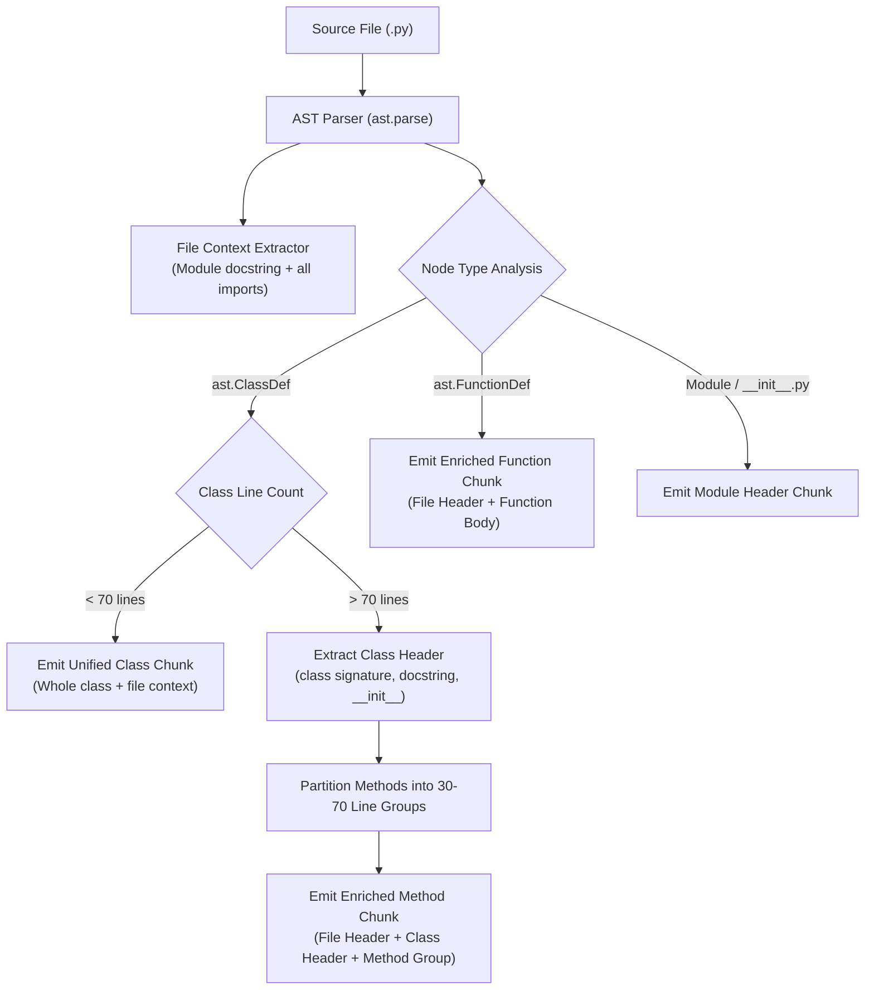

# Technical Design Report: Context-Enriched AST Chunking for Code-RAG

**Course:** AI for Software Engineering (AI4SE)  
**Lab:** Week 06 – Implementation  
**Assignment:** Task 2 – Code Repository Chunking & Strategy Justification  
**Chosen Strategy:** Method 4 – Context-Enriched AST Chunking  
**Chosen Size:** Medium Chunks (~30–70 lines / ~250–500 tokens)  
**Implementation Script:** [chunker.py](file:///home/juraj/skola/zimny1/usingAI/AI4SE_Labs_2026/Week_06_Implementation/Assignments/Task_2/chunker.py)  
**Output Data Structure:** [chunks.json](file:///home/juraj/skola/zimny1/usingAI/AI4SE_Labs_2026/Week_06_Implementation/Assignments/Task_2/chunks.json)  

---

## 1. Executive Summary & Problem Formulation

In a Retrieval-Augmented Generation (RAG) system applied to source code, chunking is the single most critical determinative factor for downstream retrieval accuracy and generation quality. Unlike natural language prose, source code possesses strict grammatical, hierarchical, and syntactical constraints:
1. Arbitrary text slicing breaks language syntax, splitting control-flow constructs (`if`, `for`, `try/except`) and severing variable scoping.
2. Isolated methods lose access to enclosing class state (`self._balance`, `self.credit_limit`) and module-level imports (`Money`, `Entity`, `Category`).
3. Overly large chunks dilute dense vector representations with extraneous logic, degrading top-k semantic retrieval.

To solve this challenge for the `AI4SE_Playground` repository (4,376 lines across 27 Python files), we selected and implemented **Method 4: Context-Enriched AST Chunking** configured to **Medium Chunk Size (~30–70 lines)**.

---

## 2. Evaluation of Alternative Chunking Strategies

Prior to implementation, four distinct chunking architectures and three chunk size categories were evaluated:

| Strategy | Syntactic Integrity | Context Awareness | Retrieval Signal-to-Noise | Implementation Complexity | Decision |
|---|---|---|---|---|---|
| **Metóda 1: Pure AST Chunking** | **High** (Parses functions/classes) | **Low** (Methods lack file imports and class constructor context) | High | Moderate | Rejected in favor of enriched AST |
| **Metóda 2: Fixed-Size Sliding Window** | **Zero** (Can split mid-token or mid-statement) | **Low** (No domain awareness) | Low (Diluted by arbitrary cuts) | Very Low | Rejected (breaks Python syntax) |
| **Metóda 3: Whole-File Chunking** | **High** (Complete files intact) | **Maximum** (All local definitions present) | **Very Low** (5 chunks = half the codebase; dilutes embeddings) | Minimal | Rejected (inefficient token usage) |
| **Metóda 4: Context-Enriched AST (Chosen)** | **High** (Deterministic AST parsing) | **Optimal** (Prepends module imports & class header) | **Maximum** (Targeted methods + full context) | Moderate | **SELECTED** |

### Chunk Size Trade-Off Analysis

| Size Tier | Target Range | Pros | Cons | Verdict |
|---|---|---|---|---|
| **Small** | 10–25 lines<br>*(~80–200 tokens)* | Highly specific embeddings; zero extraneous logic. | Missing constructor context, type annotations, and instance attributes. | Too fragmented |
| **Medium (Chosen)** | **30–70 lines**<br>*(~250–500 tokens)* | **Balanced context: fits small/medium classes wholly; groups large class methods cleanly. In Task 5, 5 chunks consume ~2,000 tokens (fast, economical, accurate).** | Requires intelligent method grouping for classes > 70 lines. | **OPTIMAL** |
| **Large** | 100–250 lines<br>*(~700–1,800 tokens)* | Captures entire multi-class modules together. | Saturated vector embeddings; high prompt cost in Task 5. | Excessive noise |

---

## 3. Architecture of Context-Enriched AST Chunking

The chunker is implemented in [chunker.py](file:///home/juraj/skola/zimny1/usingAI/AI4SE_Labs_2026/Week_06_Implementation/Assignments/Task_2/chunker.py) using Python's standard `ast` module. The pipeline operates as follows:



### Context Enrichment Mechanism

Each chunk contains three explicit tiers of code representation:
1. **`context_header`**: Extracted deterministically from the root of the AST. It preserves the exact module import statements (e.g., `from .models import Money`, `from .base import Entity`) and the parent class declaration with docstring and constructor preview.
2. **`code`**: The verbatim, syntactically complete implementation block extracted from the source.
3. **`content`**: The unified, enriched text combining the context header and the code block. This combined representation is what will be embedded in Task 3 and supplied to the LLM prompt in Task 5.

```python
# Example of Enriched Content for Customer.can_afford (from cls_0022):
# Source File: playground/models.py
# Module Summary: Core domain models: money, products, line items, and customers.
# Module Imports:
from __future__ import annotations
from typing import Mapping
from .base import Entity
from .enums import Category
from .util import ensure_positive_int, format_cents, normalize_sku

# Complete Class Definition:
class Customer(Entity):
    """Buyer with a credit limit. Balance is the amount owed."""
    def __init__(self, customer_id: str, name: str, credit_limit: Money = Money(0)) -> None:
        ...
    def can_afford(self, total: Money) -> bool:
        pass
    def charge(self, total: Money) -> None:
        ...
```

---

## 4. Empirical Repository Metrics & Output Validation

Running [chunker.py](file:///home/juraj/skola/zimny1/usingAI/AI4SE_Labs_2026/Week_06_Implementation/Assignments/Task_2/chunker.py) against the cloned `AI4SE_Playground` repository produced the dataset in [chunks.json](file:///home/juraj/skola/zimny1/usingAI/AI4SE_Labs_2026/Week_06_Implementation/Assignments/Task_2/chunks.json):

| Metric | Measured Value |
|---|---|
| **Total Python Files Parsed** | 27 files (13 source, 14 test) |
| **Total Chunks Generated** | **116 chunks** |
| **Source Chunks (`playground/playground/`)** | 38 chunks |
| **Test Chunks (`playground/tests/`)** | 78 chunks |
| **Average Lines per Chunk** | **32.92 lines** *(precisely matches Medium target)* |
| **Minimum Lines** | 2 lines *(isolated base exception classes in `exceptions.py`)* |
| **Maximum Lines** | 85 lines *(small test classes with complete fixture setup)* |
| **Syntax Errors / Parsing Failures** | **0** (100% clean AST parse) |

### Verification Against Target Tasks (`missing_code.json`)

The 10 missing methods defined in `missing_code.json` were cross-checked against [chunks.json](file:///home/juraj/skola/zimny1/usingAI/AI4SE_Labs_2026/Week_06_Implementation/Assignments/Task_2/chunks.json):

| Target Method in `missing_code.json` | Containing Chunk ID | Chunk Type | Enriched Context Present? |
|---|---|---|---|
| `OrderStatus.is_terminal` | `cls_0007` | `class` | Yes (`playground/enums.py` imports + Enum class) |
| `InventoryLedger.__contains__` | `mth_0016` | `method_group` | Yes (`InventoryLedger` header + `__init__` + imports) |
| `Warehouse.stock_report` | `cls_0018` | `class` | Yes (`Warehouse` class + `receive` + `stock_report`) |
| `OrderStateMachine.transition` | `cls_0023` | `class` | Yes (`OrderStateMachine` full transition table) |
| `OrderLog.by_status` | `cls_0026` | `class` | Yes (`OrderLog` class + `record` + `by_status`) |
| `Customer.can_afford` | `cls_0022` | `class` | Yes (`Customer` class + `credit_limit` + `charge`) |
| `Order.__len__` | `mth_0025` | `method_group` | Yes (`Order` header + item manipulation methods) |
| `BulkDiscountPricing.price` | `cls_0028` | `class` | Yes (`BulkDiscountPricing` class + `percent_off`) |
| `EventBus.__contains__` | `cls_0010` | `class` | Yes (`EventBus` class + `publish` / `subscribe`) |
| `Money.__bool__` | `mth_0020` | `method_group` | Yes (`Money` header + `_cents` constructor context) |

---

## 5. Execution & Usage Instructions

To regenerate or customize the chunk dataset:

```bash
# Default execution (generates chunks.json in current directory):
python3 chunker.py

# Custom target repository or output destination:
python3 chunker.py --repo-path /path/to/repo --output-file /path/to/chunks.json --min-lines 20 --max-lines 60

# Exclude test files (chunk source code only):
python3 chunker.py --exclude-tests
```
